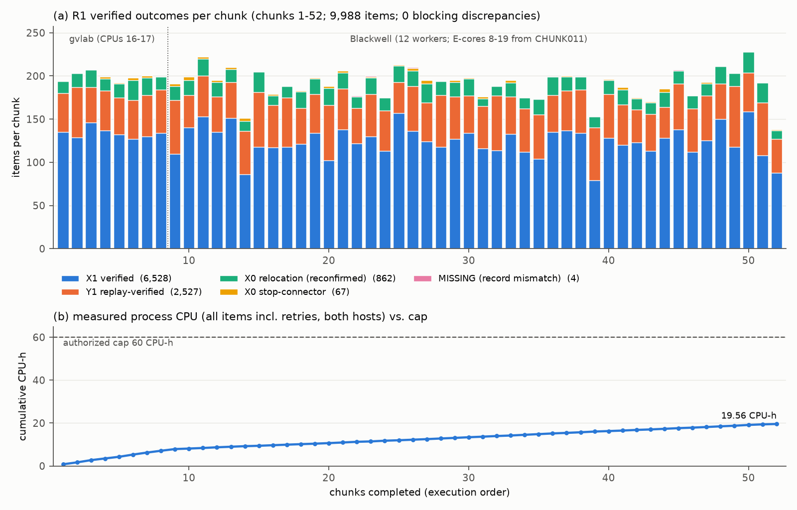

# R1: historical 3D X/Y recovery report (BD3DS66)

**Status: COMPLETE.** All 52 chunks (1–52) were done on 2026-11-08 between 07:47Z and 15:36Z. There were 0 blocking discrepancies, and **19.56 of the authorized 60 CPU-h** were used.

The evidence is in:
- `results_r1/` (ledger, summary, handover checksums);
- `results_parity/`;
- `results_r1_diag/`.

The figure is `figures/R1_OUTCOMES_AND_BUDGET.png`, produced by `fig_r1.py` from the committed ledger only.

## 1. What was run

The input is the canonical S2 recovery manifest (`S2_RECOVERY_MANIFEST.json.gz`): 10,190 items in 53 root-sharded chunks. CHUNK000 (202 items) was done earlier in the S2 pilot. R1 covers **chunks 1–52, 9,988 items**:

| Action (teacher) | Items | Outcomes |
|---|---:|---|
| `REPLAY_RELOCATIONS+CONNECTOR+INDEPENDENT_REPLAY` (BD3DS66_X_V1) | 6,595 | 6,528 **X1_VERIFIED** · 67 **X0_STOP_CONNECTOR_NO_PLAN** |
| `REPLAY_STORED_TARGET_WITNESS` (BD3DS66_Y_REPLAY_V1) | 2,527 | 2,527 **Y1_REPLAY_VERIFIED** |
| `REPLAY_TO_FAILING_STEP+RECONFIRM` (archived X0 negatives) | 866 | 862 **X0_RELOCATION_FAILED_RECONFIRMED** · 4 **MISSING** (§4) |

**By split:**

| Split | X1 verified | X0 relocation | X0 connector | MISSING | Y1 replay |
|---|---:|---:|---:|---:|---:|
| train | 4,614 | 612 | 51 | 3 | 1,757 |
| val | 977 | 122 | 11 | 1 | 387 |
| test | 937 | 128 | 5 | 0 | 383 |

Test-split labels are recorded but are **refused** by every training and development tool (`test_roots_used = 0`).

**How a label is earned:**
- **X=1** needs all three of:
  1. every stored relocation witness replays in carried state;
  2. the stop-point connector to the fixed `q_ref` executes;
  3. a fresh-process independent replay agrees.
- **X=0** is one of:
  - a re-confirmed relocation failure, using the same failing step and the same planning outcome;
  - a connector that finds no plan to `q_ref`, labelled only for that stopping prefix.
- Planning-only positives are never labels.

## 2. Hosts, handover and parity

**gvlab, CPUs 16–17, 2 workers** (the contract allocation):
- Ran chunks 1–8 and 178 of CHUNK009's 191 items.
- Used 7.86 CPU-h at about 27–34 min per chunk.
- Was stopped by `STOP_REQUESTED` at 12:26Z, under the user-approved plan to move R1 to Blackwell once it was free.

**Parity before the handover:**
- The sample was 18 verified gvlab items, 34 teacher/replay records, re-run on Blackwell with identical source hashes and q_ready.
- **PASS:**
  - 34/34 labels agree;
  - 34/34 per-move steps agree (end cell, ok);
  - the largest z-error difference is 7.4e-7 m;
  - the largest final-state difference is 2.7e-5 (cross-CPU floating point).

**Transfer:** `out_r1` (4,589 files) was relayed with every sha256 verified (`results_r1/out_r1_HANDOVER_SHA256.txt.gz`).

**Blackwell** (Core Ultra 9 285K, shared with collaborators) ran from CHUNK009 on and used 11.70 CPU-h at about 2–3 min per chunk.
- **Thermal:** 12 workers that included P-cores 0–6 pushed the package to 85–87 °C within seconds. The 85 °C guard stopped CHUNK011 cleanly.
- **Restart:** on **E-cores 8–19 only** (12 workers), the package stayed at 50–65 °C.
- **Reserved cores:** CPU 7 for the GPU job; CPUs 20–23 always free. At least 12 cores stayed idle, satisfying the ≥ 4 rule.

## 3. Stops and how each was resolved

Every stop was clean. Items are written idempotently, so a stop never loses or duplicates a label. Each partial chunk record was moved to `handover_partial_records`, so the finals are never double-counted.

| UTC | Chunk | Cause | Resolution |
|---|---|---|---|
| 12:26 | 009 | `STOP_REQUESTED`, the planned gvlab → Blackwell handover | Resumed on Blackwell after parity PASS |
| 12:30 | 011 | TEMP guard (85–87 °C, P-cores) | Cooled to 34 °C, then restarted on E-cores 8–19 |
| 12:57 | 045 | Discrepancy: negative-subtype mismatch (§4) | Diagnosed; user approved the non-blocking rule |
| 13:27 | 015 | QUEUE yield guard (a collaborator's CPU queue had 6 pending jobs) | Waited for the queue to drain, then resumed at 14:03 |
| 14:29 | 026 | Discrepancy: archived negative not re-confirmed (§4) | Diagnosed; user approved the non-blocking rule |

## 4. The 4 MISSING items: archived negatives that disagree with the pinned teacher

All four come from `REPLAY_TO_FAILING_STEP+RECONFIRM`. In each one, every earlier relocation replays exactly as recorded, and only the archived failing step disagrees.

| Item | Split | Archived negative | Pinned-teacher re-query | Category (user-approved, non-blocking) |
|---|---|---|---|---|
| `S2X-3ds66-srv3-w0090-s023-08710` | val | NO_PLAN_FOUND (relocation 4) | no plan; all 32 grasps fail deterministic geometric checks, so CERTIFIED | subtype mismatch |
| `S2X-3ds66-srv3-w0069-s018-04396` | train | CERTIFIED (relocation 4) | no plan, NO_PLAN_FOUND | subtype mismatch |
| `S2X-3ds66-srv-w0045-s001-04657` | train | NO_PLAN_FOUND (relocation 1) | no plan, CERTIFIED | subtype mismatch |
| `S2X-3ds66-srv3-w0096-s010-05116` | train | CERTIFIED (relocation 3) | **a plan is found** | negative not re-confirmed |

**Diagnosis** (`results_r1_diag/`): `08710` and `05116` were re-run on gvlab and on Blackwell P- and E-cores. Per-grasp reasons and planning outcomes are **identical across hosts**. These are disagreements between the archived production record and the pinned teacher, **not** host artefacts.

**Handling:**
- No label is written for any of the four. X=1 was never executed, and X=0 is not re-confirmed.
- They are listed in the ledger under `nonblocking_negative_subtype_mismatch` and `nonblocking_negative_not_reconfirmed`.
- Every other discrepancy type still stops the run (`bwlsuper.subtype_only`, `bwlsuper.negative_not_reconfirmed`).

**Rate:** 4 of 866 archived negatives (0.46 %); only 1 of 866 (0.12 %) turned out to be plannable.

## 5. Budget and guards

- **CPU:** 19.56 CPU-h measured, counting the process CPU of every item including retries, on both hosts. The cap is 60, with a reserve of 1.5.
- **Wall:** about 7.8 h from the ledger t0, within the 42 h wall cap.
- **Guard checks:**
  - the per-item guard ran on every item: temperature, memory, swap growth, plus on Blackwell the idle-core count, the yadu-process yield and the collaborator-queue yield;
  - no collaborator process was touched;
  - no Q2 interference: gvlab Q2 ran on CPUs 0–13 throughout.
- **Missing-Y bulk job:** not run. It was not approved; an explicit "c" is required.

## 6. Output

**Sidecar V1** (`results_r4/BD3DS66_XY_SIDECAR_V1.json.gz`, from S1 + S2-C000 + R1 + R2): **7,656 X / 7,072 Y labels, 0 conflicts**, with 692 same-endpoint order groups decided, 25 of them discordant. Intake and the development smoke are in `R4_BLACKWELL_INTAKE_AND_SMOKE.md`.
