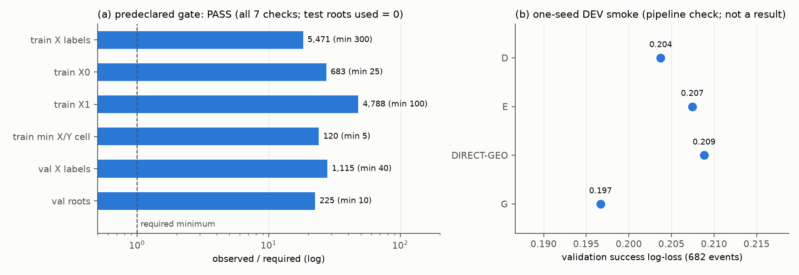

# R4: Blackwell 3D intake and development-only smoke

**Status: COMPLETE** (2026-11-08, 15:37–15:39Z).
- **Gate:** the label gate declared before any fit **PASSES**.
- **Smoke:** a one-seed DEVELOPMENT-ONLY smoke of D / E / DIRECT-GEO / G ran on GPU 0 + CPU 7, using about 1 GPU-minute of the ≤ 6 GPU-h cap. **This is a pipeline check, not a result. No arm is ranked, and nothing was tuned on test or P24 data.**

The evidence is in `results_r4/`:
- `BD3DS66_XY_SIDECAR_V1.json.gz`;
- `intake_v1.json`;
- `GATE.json`;
- `SMOKE.json`;
- `smoke_v1.log`;
- `watchdog.jsonl`.

The figure is `figures/R4_GATE_AND_SMOKE.png` (`fig_r4.py`, built from `GATE.json` and `SMOKE.json` only). The checkpoints (`*_best.pt`) stay on the server and are not committed.

## 1. Sidecar V1

`combine_labels.py` joined four verified sources:
- S1 pilot;
- S2 CHUNK000;
- R1 chunks 1–52;
- R2 missing-Y pilot.

They were joined against the pinned raw roots, and produced **7,656 X / 7,072 Y labels with 0 conflicts**.

**Y labels by source:**

| Source | Y labels |
|---|---:|
| Replay-verified (`Y_REPLAY_VERIFIED`) | 2,645 |
| R2 plan → execute → replay verified | 35 |
| R2 attempted negatives | 31 (23 CERTIFIED, 8 NO_PLAN_FOUND) |
| Archived operational negatives on the X roots' endpoints, scope kept | 4,361 |

**Not labels:** planning-only positives and unattempted queries stay MISSING. So do the 4 R1 record-mismatch items (`R1_RECOVERY_REPORT.md` §4).

**Order structure:** 692 same-endpoint order groups (m ≥ 2) are decided; 25 are discordant, meaning the order of relocations changes X for the same endpoint.

## 2. Intake gate (declared before any fit, `xy3d_train.GATE`)

| Check | Observed | Required |
|---|---:|---:|
| train X labels | 5,471 | ≥ 300 |
| train X0 / X1 | 683 / 4,788 | ≥ 25 / ≥ 100 |
| train paired X/Y cells (X1Y0, X1Y1, X0Y0, X0Y1) | 1,402 / 1,119 / 203 / 120 | each ≥ 5 |
| val X labels / val roots | 1,115 / 225 | ≥ 40 / ≥ 10 |
| test roots used | 0 | = 0 |

**Result: PASS.** 1,035 train roots and 225 val roots carry labels. Test roots are refused by construction.

## 3. Development smoke (one seed, GPU 0 + CPU 7)

**Setup:**
- `xy3d.XYNet` for each arm (469,895 parameters), trained with `XYNet.loss` (exact root-mean observed-data NLL, κ SYM; success BCE for DIRECT-GEO).
- `bxy_p11.TRAIN` optimizer: AdamW 1e-3, weight decay 1e-4, clip 10, 12 roots per batch, evaluation every 20 updates, patience 15, ≤ 3,000 updates.
- float32.
- Validation is used only for early stopping and reporting.

| Arm | val success log-loss | val X marginal log-loss | val Y log-loss | best / last update | wall |
|---|---:|---:|---:|---:|---:|
| D | 0.204 | 0.231 | 0.222 | 1,460 / 1,760 | 16.0 s |
| E | 0.207 | 0.221 | 0.230 | 1,700 / 2,000 | 17.7 s |
| DIRECT-GEO | 0.209 | n/a | n/a | 620 / 920 | 6.9 s |
| G | 0.197 | 0.234 | 0.218 | 1,840 / 2,140 | 19.2 s |

All rows are scored on the same 682 validation success events.

**Resources:** peak VRAM 64 MB; affinity {7}; the resource watchdog never fired (no foreign GPU processes, no queue pending, no yield processes).

**Reading:** all four arms train to an early-stopped optimum on authentic BD3DS66 labels. The 3D intake → views → loss → optimizer path works end to end on real data.

The differences between arms (≤ 0.012 nats) come from **one seed** on validation only. They carry **no** evidential weight about arm superiority. A matched multi-seed study under the preregistered protocol is required before any comparison.

## 4. What R4 did not do

- No P24 or test evaluation.
- No hyper-parameter tuning.
- No sampler verdict: it stays INCONCLUSIVE, per R3.
- No Q2 intake: that waits for the Q2 merge.
- No travel labels: the λ_J term is absent.
