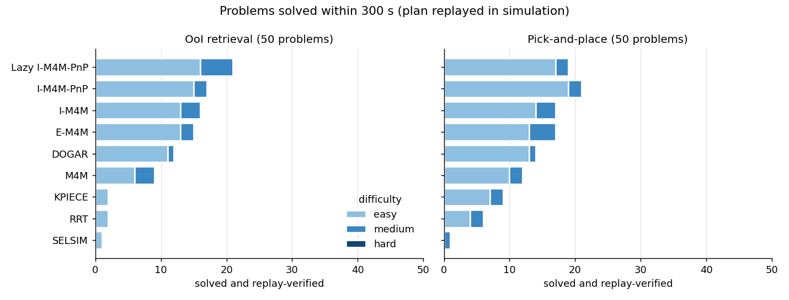
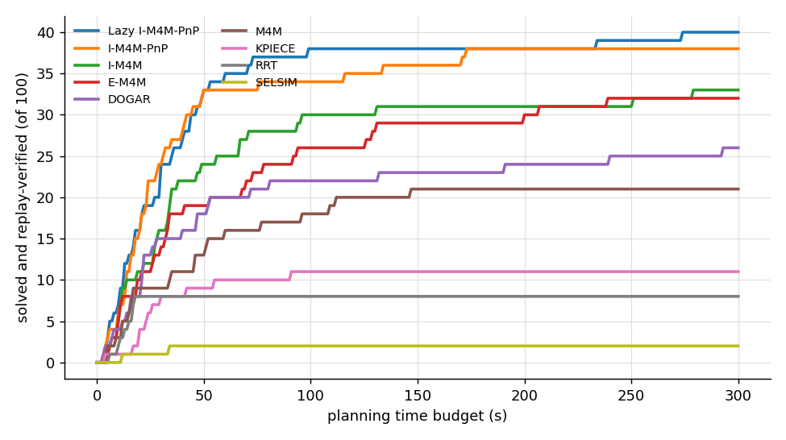

# Overnight run 2: all baselines, OoI retrieval and pick-and-place

Experiment `D:/RRC/New folder/m4m_em4m_project/mamo/workspace/experiments/20261025-225753_overnight2`; dataset `overnight2` (100 problems); 9 methods, one seed, at most 300 s of planning per run, 900 runs. A run counts as solved only if its plan, replayed from the initial scene in MuJoCo, succeeds (the OoI is out of its shelf / every target is at its goal).

**Most problems solved: Lazy I-M4M-PnP, 40 of 100.**

## Solved per method and task

| Method | OoI retrieval | Pick-and-place | Total |
|---|---|---|---|
| Lazy I-M4M-PnP | 21/50 | 19/50 | **40/100** |
| I-M4M-PnP | 17/50 | 21/50 | **38/100** |
| I-M4M | 16/50 | 17/50 | **33/100** |
| E-M4M | 15/50 | 17/50 | **32/100** |
| DOGAR | 12/50 | 14/50 | **26/100** |
| M4M | 9/50 | 12/50 | **21/100** |
| KPIECE | 2/50 | 9/50 | **11/100** |
| RRT | 2/50 | 6/50 | **8/100** |
| SELSIM | 1/50 | 1/50 | **2/100** |

## Solved per method and difficulty (both tasks)

| Method | easy | medium | hard | Total |
|---|---|---|---|---|
| Lazy I-M4M-PnP | 33/50 | 7/30 | 0/20 | **40/100** |
| I-M4M-PnP | 34/50 | 4/30 | 0/20 | **38/100** |
| I-M4M | 27/50 | 6/30 | 0/20 | **33/100** |
| E-M4M | 26/50 | 6/30 | 0/20 | **32/100** |
| DOGAR | 24/50 | 2/30 | 0/20 | **26/100** |
| M4M | 16/50 | 5/30 | 0/20 | **21/100** |
| KPIECE | 9/50 | 2/30 | 0/20 | **11/100** |
| RRT | 6/50 | 2/30 | 0/20 | **8/100** |
| SELSIM | 1/50 | 1/30 | 0/20 | **2/100** |

## OoI retrieval: per difficulty

| Method | easy | medium | hard | Total |
|---|---|---|---|---|
| Lazy I-M4M-PnP | 16/25 | 5/15 | 0/10 | **21/50** |
| I-M4M-PnP | 15/25 | 2/15 | 0/10 | **17/50** |
| I-M4M | 13/25 | 3/15 | 0/10 | **16/50** |
| E-M4M | 13/25 | 2/15 | 0/10 | **15/50** |
| DOGAR | 11/25 | 1/15 | 0/10 | **12/50** |
| M4M | 6/25 | 3/15 | 0/10 | **9/50** |
| KPIECE | 2/25 | 0/15 | 0/10 | **2/50** |
| RRT | 2/25 | 0/15 | 0/10 | **2/50** |
| SELSIM | 1/25 | 0/15 | 0/10 | **1/50** |

## Pick-and-place: per difficulty

| Method | easy | medium | hard | Total |
|---|---|---|---|---|
| Lazy I-M4M-PnP | 17/25 | 2/15 | 0/10 | **19/50** |
| I-M4M-PnP | 19/25 | 2/15 | 0/10 | **21/50** |
| I-M4M | 14/25 | 3/15 | 0/10 | **17/50** |
| E-M4M | 13/25 | 4/15 | 0/10 | **17/50** |
| DOGAR | 13/25 | 1/15 | 0/10 | **14/50** |
| M4M | 10/25 | 2/15 | 0/10 | **12/50** |
| KPIECE | 7/25 | 2/15 | 0/10 | **9/50** |
| RRT | 4/25 | 2/15 | 0/10 | **6/50** |
| SELSIM | 0/25 | 1/15 | 0/10 | **1/50** |

## Solved per environment (both tasks)

| Method | access19 | confined_shelf | multi_level_shelf | open_tabletop | stacking | Total |
|---|---|---|---|---|---|---|
| Lazy I-M4M-PnP | 3/21 | 12/20 | 13/20 | 3/19 | 9/20 | **40/100** |
| I-M4M-PnP | 4/21 | 10/20 | 11/20 | 4/19 | 9/20 | **38/100** |
| I-M4M | 0/21 | 9/20 | 12/20 | 1/19 | 11/20 | **33/100** |
| E-M4M | 0/21 | 8/20 | 12/20 | 1/19 | 11/20 | **32/100** |
| DOGAR | 0/21 | 7/20 | 9/20 | 1/19 | 9/20 | **26/100** |
| M4M | 1/21 | 8/20 | 8/20 | 1/19 | 3/20 | **21/100** |
| KPIECE | 0/21 | 2/20 | 2/20 | 3/19 | 4/20 | **11/100** |
| RRT | 0/21 | 1/20 | 0/20 | 3/19 | 4/20 | **8/100** |
| SELSIM | 0/21 | 0/20 | 0/20 | 0/19 | 2/20 | **2/100** |

## Planning time of the solved runs

| Method | median (s) | mean (s) | solved within 60 s | within 120 s | within 300 s |
|---|---|---|---|---|---|
| Lazy I-M4M-PnP | 27.8 | 40.4 | 35 | 38 | 40 |
| I-M4M-PnP | 23.0 | 36.9 | 33 | 35 | 38 |
| I-M4M | 32.9 | 50.0 | 25 | 30 | 33 |
| E-M4M | 33.4 | 60.3 | 20 | 26 | 32 |
| DOGAR | 23.4 | 56.9 | 20 | 22 | 26 |
| M4M | 35.0 | 45.8 | 16 | 20 | 21 |
| KPIECE | 23.7 | 31.5 | 10 | 11 | 11 |
| RRT | 13.8 | 12.9 | 8 | 8 | 8 |
| SELSIM | 22.7 | 22.7 | 2 | 2 | 2 |

## Why runs failed

| Method | reason | runs |
|---|---|---|
| Lazy I-M4M-PnP | budget exhausted | 42 |
| Lazy I-M4M-PnP | OPEN exhausted | 17 |
| Lazy I-M4M-PnP | no retrieval trajectory without movables | 1 |
| I-M4M-PnP | budget exhausted | 41 |
| I-M4M-PnP | OPEN exhausted | 17 |
| I-M4M-PnP | replay failed: push 8/8 invalid on replay: immovable contact: obj / obj | 1 |
| I-M4M-PnP | no retrieval trajectory without movables | 1 |
| I-M4M-PnP | replay failed: push 5/15 invalid on replay: object 7 fell off the shelf | 1 |
| I-M4M-PnP | return home after target 1: object 14 fell off its surface | 1 |
| I-M4M | OPEN exhausted | 50 |
| I-M4M | budget exhausted | 15 |
| I-M4M | no retrieval trajectory without movables | 1 |
| I-M4M | replay failed: push 4/4 invalid on replay: immovable contact: obj / obj | 1 |
| E-M4M | OPEN exhausted | 50 |
| E-M4M | budget exhausted | 17 |
| E-M4M | replay failed: push 1/1 invalid on replay: object 7 tilted 25 deg | 1 |
| DOGAR | budget exhausted | 72 |
| DOGAR | no retrieval trajectory without movables | 1 |
| DOGAR | replay failed: retrieval segment 'lift': object 6 tilted 73 deg | 1 |
| M4M | budget exhausted | 49 |
| M4M | no MAPF-suggested push left | 22 |
| M4M | CBS failed | 6 |
| M4M | no retrieval trajectory without movables | 1 |
| M4M | replay failed: retrieval segment 'lift': object 7 tilted 90 deg | 1 |
| KPIECE | budget exhausted | 89 |
| RRT | budget exhausted | 90 |
| RRT | no grasp for the OoI | 1 |
| RRT | replay failed: retrieval segment 'extract': object 10 fell off the shelf | 1 |
| SELSIM | budget exhausted | 96 |
| SELSIM | tracking failed, no irrelevant object to blame: robot hit shelf: sh | 2 |

## Findings

* **Overall winner: Lazy I-M4M-PnP** (40 of 100), then I-M4M-PnP (38), I-M4M (33) and E-M4M (32). On pick-and-place alone, I-M4M-PnP is first (21 of 50). Lazy I-M4M-PnP is first on OoI retrieval (21 of 50). The two pick-and-place variants of I-M4M are also the only methods that solve Access-19 more than once (3-4 of 21).
* **No method solves a hard problem within 300 s** (0 of 20, both tasks). The E-M4M / I-M4M family searches to the end there ("OPEN exhausted": every vertex closed without a plan). DOGAR, M4M, RRT, KPIECE and SELSIM run out of time. Hard problems now have 3-6 (retrieval) or 4-8 (pick-and-place, 2-3 targets) movables in the NGR, and their immovables stand next to the access corridors. In the first overnight run (900 s, idle machine, no such immovables) the best method solved 4 of 17 hard retrievals. As generated, the hard level is beyond every baseline. If you want hard problems that separate the methods, relax them: fewer blockers, or immovables not next to the corridors.
* **Medium** problems separate the methods (best 7 of 30). **Easy** ones are solved by the M4M family most of the time (I-M4M-PnP 34 of 50).
* **Physics-based sampling baselines are weak, as in the M4M papers**: KPIECE 11, RRT 8, SELSIM 2 of 100. They search the joint space of a 7-DoF arm, and almost all of their runs end at the budget. KPIECE does better on pick-and-place (9 of 50) than on retrieval (2 of 50). SELSIM's single-joint motion steps rarely bring the gripper near the pre-grasp pose in these shelves within 300 s (most runs: 0 goal checks).
* **Environments**: the multi-level shelf, the confined shelf and 3D stacking are solved most often. The open tabletop (dense cylinders, side grasps) and Access-19 (narrow bookcase) are hardest for every method.
* **Replay**: 7 of the 218 plans that planners returned failed when replayed from the initial scene in MuJoCo (tilted or fallen objects, contact with an immovable). They count as failures.
* **One retrieval problem** (`multi_level_shelf_retrieve_hard_0000`): with seed 0, five methods failed to plan even the initial retrieval with only immovables as obstacles. That step is sampling-based, and the problem generator had succeeded with another seed.
* **Load**: 8 runs in parallel on 6 cores, so the 300 s budget (wall clock) buys less planning than on an idle machine. Every method ran under the same load.

## Files

* `results.csv`: one row per run
* `<baseline>/results.csv`, `<baseline>/solutions/<task>/*.pkl` (plans, `mamo.solution.Solution`), `<baseline>/gifs/<task>/*.gif` (every solved run replayed, iso and top view)
* `dataset/`: the problems (scene files), `dataset/labels.csv` their labels
