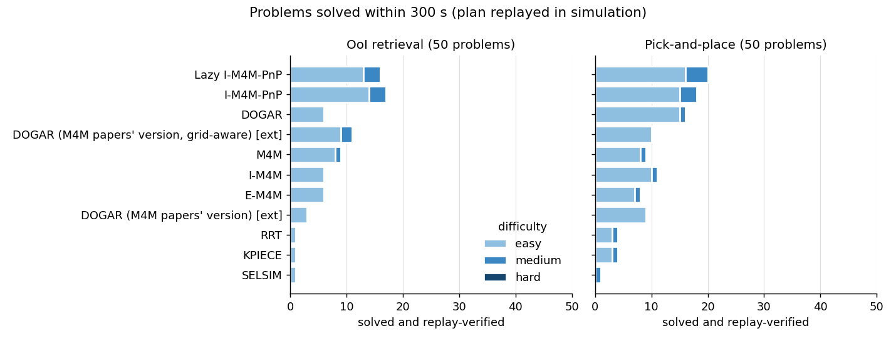
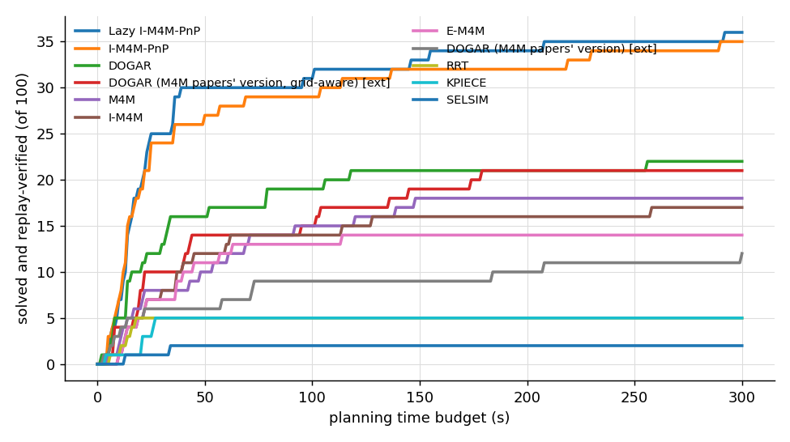

# Overnight run 3: all baselines on grid states, OoI retrieval and pick-and-place

Experiment `workspace/experiments/20261027-232422_overnight3`; dataset `overnight3` (100 problems); 11 methods, one seed, at most 300 s of planning per run, 1100 runs. A run counts as solved only if its plan, replayed from the initial scene in MuJoCo, succeeds (the OoI is out of its shelf / every target is at its goal).

**Most problems solved: Lazy I-M4M-PnP, 36 of 100.**

## Solved per method and task

| Method | OoI retrieval | Pick-and-place | Total |
|---|---|---|---|
| Lazy I-M4M-PnP | 16/50 | 20/50 | **36/100** |
| I-M4M-PnP | 17/50 | 18/50 | **35/100** |
| DOGAR | 6/50 | 16/50 | **22/100** |
| DOGAR (M4M papers' version, grid-aware) [ext] | 11/50 | 10/50 | **21/100** |
| M4M | 9/50 | 9/50 | **18/100** |
| I-M4M | 6/50 | 11/50 | **17/100** |
| E-M4M | 6/50 | 8/50 | **14/100** |
| DOGAR (M4M papers' version) [ext] | 3/50 | 9/50 | **12/100** |
| RRT | 1/50 | 4/50 | **5/100** |
| KPIECE | 1/50 | 4/50 | **5/100** |
| SELSIM | 1/50 | 1/50 | **2/100** |

## Solved per method and difficulty (both tasks)

| Method | easy | medium | hard | Total |
|---|---|---|---|---|
| Lazy I-M4M-PnP | 29/50 | 7/30 | 0/20 | **36/100** |
| I-M4M-PnP | 29/50 | 6/30 | 0/20 | **35/100** |
| DOGAR | 21/50 | 1/30 | 0/20 | **22/100** |
| DOGAR (M4M papers' version, grid-aware) [ext] | 19/50 | 2/30 | 0/20 | **21/100** |
| M4M | 16/50 | 2/30 | 0/20 | **18/100** |
| I-M4M | 16/50 | 1/30 | 0/20 | **17/100** |
| E-M4M | 13/50 | 1/30 | 0/20 | **14/100** |
| DOGAR (M4M papers' version) [ext] | 12/50 | 0/30 | 0/20 | **12/100** |
| RRT | 4/50 | 1/30 | 0/20 | **5/100** |
| KPIECE | 4/50 | 1/30 | 0/20 | **5/100** |
| SELSIM | 1/50 | 1/30 | 0/20 | **2/100** |

## OoI retrieval: per difficulty

| Method | easy | medium | hard | Total |
|---|---|---|---|---|
| Lazy I-M4M-PnP | 13/25 | 3/15 | 0/10 | **16/50** |
| I-M4M-PnP | 14/25 | 3/15 | 0/10 | **17/50** |
| DOGAR | 6/25 | 0/15 | 0/10 | **6/50** |
| DOGAR (M4M papers' version, grid-aware) [ext] | 9/25 | 2/15 | 0/10 | **11/50** |
| M4M | 8/25 | 1/15 | 0/10 | **9/50** |
| I-M4M | 6/25 | 0/15 | 0/10 | **6/50** |
| E-M4M | 6/25 | 0/15 | 0/10 | **6/50** |
| DOGAR (M4M papers' version) [ext] | 3/25 | 0/15 | 0/10 | **3/50** |
| RRT | 1/25 | 0/15 | 0/10 | **1/50** |
| KPIECE | 1/25 | 0/15 | 0/10 | **1/50** |
| SELSIM | 1/25 | 0/15 | 0/10 | **1/50** |

## Pick-and-place: per difficulty

| Method | easy | medium | hard | Total |
|---|---|---|---|---|
| Lazy I-M4M-PnP | 16/25 | 4/15 | 0/10 | **20/50** |
| I-M4M-PnP | 15/25 | 3/15 | 0/10 | **18/50** |
| DOGAR | 15/25 | 1/15 | 0/10 | **16/50** |
| DOGAR (M4M papers' version, grid-aware) [ext] | 10/25 | 0/15 | 0/10 | **10/50** |
| M4M | 8/25 | 1/15 | 0/10 | **9/50** |
| I-M4M | 10/25 | 1/15 | 0/10 | **11/50** |
| E-M4M | 7/25 | 1/15 | 0/10 | **8/50** |
| DOGAR (M4M papers' version) [ext] | 9/25 | 0/15 | 0/10 | **9/50** |
| RRT | 3/25 | 1/15 | 0/10 | **4/50** |
| KPIECE | 3/25 | 1/15 | 0/10 | **4/50** |
| SELSIM | 0/25 | 1/15 | 0/10 | **1/50** |

## Solved per environment (both tasks)

| Method | access19 | confined_shelf | multi_level_shelf | open_tabletop | stacking | Total |
|---|---|---|---|---|---|---|
| Lazy I-M4M-PnP | 2/21 | 11/20 | 12/20 | 5/19 | 6/20 | **36/100** |
| I-M4M-PnP | 1/21 | 12/20 | 12/20 | 5/19 | 5/20 | **35/100** |
| DOGAR | 1/21 | 7/20 | 6/20 | 5/19 | 3/20 | **22/100** |
| DOGAR (M4M papers' version, grid-aware) [ext] | 0/21 | 7/20 | 6/20 | 1/19 | 7/20 | **21/100** |
| M4M | 0/21 | 8/20 | 3/20 | 1/19 | 6/20 | **18/100** |
| I-M4M | 0/21 | 7/20 | 4/20 | 1/19 | 5/20 | **17/100** |
| E-M4M | 0/21 | 5/20 | 4/20 | 1/19 | 4/20 | **14/100** |
| DOGAR (M4M papers' version) [ext] | 0/21 | 6/20 | 3/20 | 1/19 | 2/20 | **12/100** |
| RRT | 0/21 | 0/20 | 0/20 | 3/19 | 2/20 | **5/100** |
| KPIECE | 0/21 | 0/20 | 0/20 | 3/19 | 2/20 | **5/100** |
| SELSIM | 0/21 | 0/20 | 0/20 | 0/19 | 2/20 | **2/100** |

## Planning time of the solved runs

| Method | median (s) | mean (s) | solved within 60 s | within 120 s | within 300 s |
|---|---|---|---|---|---|
| Lazy I-M4M-PnP | 17.6 | 42.6 | 30 | 32 | 36 |
| I-M4M-PnP | 17.5 | 47.6 | 28 | 31 | 35 |
| DOGAR | 21.4 | 43.3 | 17 | 21 | 22 |
| DOGAR (M4M papers' version, grid-aware) [ext] | 39.4 | 59.0 | 14 | 17 | 21 |
| M4M | 45.3 | 52.8 | 11 | 16 | 18 |
| I-M4M | 36.6 | 53.8 | 13 | 15 | 17 |
| E-M4M | 29.5 | 35.8 | 12 | 14 | 14 |
| DOGAR (M4M papers' version) [ext] | 39.8 | 79.5 | 7 | 9 | 12 |
| RRT | 13.5 | 12.6 | 5 | 5 | 5 |
| KPIECE | 20.8 | 19.4 | 5 | 5 | 5 |
| SELSIM | 23.2 | 23.2 | 2 | 2 | 2 |

## Why runs failed

| Method | reason | runs |
|---|---|---|
| Lazy I-M4M-PnP | OPEN exhausted | 41 |
| Lazy I-M4M-PnP | budget exhausted | 21 |
| Lazy I-M4M-PnP | no retrieval trajectory without movables | 1 |
| Lazy I-M4M-PnP | replay failed: push 2/3 invalid on replay: bodies forced into each other (x cm): sh | 1 |
| I-M4M-PnP | OPEN exhausted | 39 |
| I-M4M-PnP | budget exhausted | 22 |
| I-M4M-PnP | no retrieval trajectory without movables | 2 |
| I-M4M-PnP | replay failed: push 2/2 invalid on replay: immovable contact: obj / obj | 1 |
| I-M4M-PnP | replay failed: push 2/3 invalid on replay: bodies forced into each other (x cm): gr | 1 |
| DOGAR | budget exhausted | 49 |
| DOGAR | budget exhausted  | 5 |
| DOGAR | replay failed: push 1/1 invalid on replay: off the grid: object 7 outside the grid's  | 2 |
| DOGAR | replay failed: push 1/1 invalid on replay: off the grid: object 7 turned 36 deg off t | 1 |
| DOGAR | replay failed: push 1/1 invalid on replay: immovable contact: obj / obj | 1 |
| DOGAR | replay failed: push 1/1 invalid on replay: off the grid: object 9 turned 34 deg off t | 1 |
| DOGAR (M4M papers' version, grid-aware) [ext] | budget exhausted | 76 |
| DOGAR (M4M papers' version, grid-aware) [ext] | no retrieval trajectory without movables | 1 |
| DOGAR (M4M papers' version, grid-aware) [ext] | replay failed: push 1/1 invalid on replay: off the grid: object 10 turned 28 deg off  | 1 |
| DOGAR (M4M papers' version, grid-aware) [ext] | replay failed: push 1/1 invalid on replay: immovable contact: obj / robot/right_fin | 1 |
| M4M | budget exhausted | 48 |
| M4M | no MAPF-suggested push left | 18 |
| M4M | CBS failed | 14 |
| M4M | no retrieval trajectory without movables | 1 |
| M4M | replay failed: grasp failed: the fingers do not both touch the OoI | 1 |
| I-M4M | OPEN exhausted | 71 |
| I-M4M | budget exhausted | 11 |
| I-M4M | no retrieval trajectory without movables | 1 |
| E-M4M | OPEN exhausted | 71 |
| E-M4M | budget exhausted | 14 |
| E-M4M | no retrieval trajectory without movables | 1 |
| DOGAR (M4M papers' version) [ext] | budget exhausted | 77 |
| DOGAR (M4M papers' version) [ext] | no retrieval trajectory without movables | 1 |
| DOGAR (M4M papers' version) [ext] | replay failed: push 1/2 invalid on replay: off the grid: object 13 turned 43 deg off  | 1 |
| DOGAR (M4M papers' version) [ext] | replay failed: push 1/1 invalid on replay: off the grid: object 6 turned 37 deg off t | 1 |
| DOGAR (M4M papers' version) [ext] | replay failed: push 1/1 invalid on replay: off the grid: object 6 turned 16 deg off t | 1 |
| DOGAR (M4M papers' version) [ext] | replay failed: push 1/2 invalid on replay: off the grid: object 7 turned 33 deg off t | 1 |
| RRT | budget exhausted | 94 |
| RRT | no grasp for the OoI | 1 |
| KPIECE | budget exhausted | 94 |
| KPIECE | no grasp for the OoI | 1 |
| SELSIM | budget exhausted | 95 |
| SELSIM | tracking failed, no irrelevant object to blame: robot hit shelf: sh | 2 |
| SELSIM | no grasp for the OoI | 1 |

## Feasibility of the problems

From `scripts/feasibility.py` (`dataset/feasibility.csv`): **feasible** = some method (a baseline or the oracle witness search, `mamo/oracle`) found a plan that replays successfully with the current simulator; **infeasible** = a necessary condition fails (the target cannot be retrieved / picked and placed in simulation even with every movable removed, 20 seeds, or the free surface is too small); **unknown** = neither.

| Task | Difficulty | feasible | infeasible | unknown |
|---|---|---|---|---|
| OoI retrieval | easy | 22 | 0 | 3 |
| OoI retrieval | medium | 8 | 0 | 7 |
| OoI retrieval | hard | 0 | 0 | 10 |
| Pick-and-place | easy | 22 | 1 | 2 |
| Pick-and-place | medium | 6 | 0 | 9 |
| Pick-and-place | hard | 0 | 3 | 7 |

Solved (replay-verified) of the 58 problems known to be feasible:

| Method | solved | of feasible |
|---|---|---|
| Lazy I-M4M-PnP | 36 | 62% |
| I-M4M-PnP | 35 | 60% |
| DOGAR | 22 | 38% |
| DOGAR (M4M papers' version, grid-aware) [ext] | 21 | 36% |
| M4M | 18 | 31% |
| I-M4M | 17 | 29% |
| E-M4M | 14 | 24% |
| DOGAR (M4M papers' version) [ext] | 12 | 21% |
| RRT | 5 | 9% |
| KPIECE | 5 | 9% |
| SELSIM | 2 | 3% |

## Notes

**What changed since overnight2.** These are the same 100 problems (the `overnight3` dataset is a copy of `overnight2`), with the same methods, budget (300 s), load (8 runs in parallel) and friction (0.8). Only the grid rule is new (README, "Grid states"): every action must leave every object in a cell of its own, upright and square to the grid. **DOGAR** is the planner of its own paper (Dogar & Srinivasa 2011: Sweep / Push-grasp / PickUp / GoTo, 36 directions, exhaustive search; README "DOGAR", decided 2026-10-28). It plans without the grid and is judged on the grid when its plan is replayed. It was run on 2026-10-28 in the same experiment under the same load (8 runs at a time). The version the M4M papers re-implement, which ran in the night as "DOGAR", is kept as `dogar_m4m` [ext]: its rows and plans were renamed, with the old files in the experiment's `backup_before_dogar2011/`. Its grid-aware form is `dogar_grid` [ext].

**Solved and replayed, overnight2 (continuous states) vs overnight3 (grid states):**

| Method | overnight2 | overnight3 |
|---|---|---|
| Lazy I-M4M-PnP | 40 | 36 |
| I-M4M-PnP | 38 | 35 |
| DOGAR (Dogar & Srinivasa 2011) | - | 22 |
| DOGAR (M4M papers' version, grid-aware) [ext] | - | 21 |
| M4M | 21 | 18 |
| I-M4M | 33 | 17 |
| E-M4M | 32 | 14 |
| DOGAR (M4M papers' version) [ext] | 26 (as "DOGAR") | 12 |
| RRT | 8 | 5 |
| KPIECE | 11 | 5 |
| SELSIM | 2 | 2 |

* **Pick-and-place survives the grid best.** A placement aims at a cell centre and turns a box only by multiples of 90 deg, so I-M4M-PnP and Lazy I-M4M-PnP lose only 3-4 problems each. Pushes cannot stop an object exactly.
* **E-M4M and I-M4M lose half their solves.** 71 of their 100 runs end with "OPEN exhausted". Under the grid each object has far fewer push goals (lattice points near a cell centre, not every free 1 cm point). Pushes that leave an object between cells or turned are invalid, and every failed push invalidates its goal (E-M4M's negative cache). So the search runs out of successors. This matches the 120 s sanity study on the easy problems (E-M4M 24 -> 13).
* **M4M loses little (21 -> 18).** It has no OPEN list to exhaust. Its failed runs end on the budget (48), with no MAPF-suggested push left (18), or with CBS failing (14).
* **DOGAR (2011) plans 44 problems, 22 replay** (6 OoI retrievals, 16 pick-and-place problems; 21 easy, 1 medium).
  * Its replayed plans are almost all PickUps: only 2 contain a Sweep. A pick-up puts the object down on the surface's 1 cm lattice, and a carried box can be set down turned, so it is often off the grid.
  * Of its 28 planned retrievals, 22 fail replay. 18 of those leave an object off the grid (turned 19-45 deg, or between cells): 12 after pick-ups, 6 after sweeps. The other 4 differ in physics: while planning, the objects not yet dealt with are removed and only the grasp and placement are simulated; the replay has every object present (an unstable simulation, bodies forced together, an immovable touched, the hand on the shelf).
  * Pick-and-place problems fare better because each stage is replayed on the grid before the next. A stage that fails is planned again, as for every method, so DOGAR keeps trying until a stage happens to land on the grid.
  * The exhaustive search almost never completes: only 1 run ended with "action library exhausted"; the rest of its failed runs hit the 300 s limit. Over all runs it tried 33,839 actions (20,808 sweeps, 13,031 pick-ups), and only 1,090 were valid.
    * About 22,000 failed on the arm's kinematics: no hand pose at the start, or no straight reach or push.
    * 8,536 sweeps had no push distance (up to 60 cm) that leaves the object outside the NGR, because walls or fixed objects are in the way.
    * 771 failed in simulation.
* **DOGAR (M4M papers' version) [ext] plans 21 problems, but only 12 plans replay.** All 9 failures are OoI retrievals whose pushes leave an object turned 16-43 deg, or outside its cell. Its goals ignore the cells, so it has no reason to stop objects on them. Its pick-and-place relocations dropped from 14/50 to 9/50 for the stage-replay reason above. 77 runs end with "budget exhausted".
* **DOGAR (M4M papers' version, grid-aware) [ext] solves 21**: 23 planned, 2 replay failures (one box turned on replay, one finger touching an immovable). It is the best push-only method on the grid. The difference from its grid-agnostic form (12) is entirely the goal sampling and the off-cell check.
* The "Why runs failed" table shows each method's 6 most common reasons, so some DOGAR replay failures are hidden there; `results.csv` (`exec_reason`) has them all.
* **RRT, KPIECE, SELSIM** move objects only through incidental contact. Under the grid, their final state must also have every object on a cell, which cuts their already few solves (RRT 8 -> 5, KPIECE 11 -> 5).
* **No method solves a hard problem**, as in overnight2.

**Feasibility (`dataset/feasibility.csv`).** The labels are 58 feasible, 4 infeasible and 38 unknown (overnight2: 61 / 2 / 37). In the evidence column, "dogar (overnight2)" is the M4M papers' version that ran there. A witness counts only if it replays under the grid. The witnesses come from the overnight3 runs, from the overnight2 and oracle plans replayed under the grid (`revalidation_grid.json`), and from a new oracle run (900 s) on the 42 problems without one.

* The oracle found 3 new witnesses (2 easy, 1 medium). DOGAR (2011) found 1 more, `open_tabletop_retrieve_easy_0003`, which no other method or the oracle solved on the grid.
* 6 problems that were feasible in overnight2 are now unknown. Their only plans leave objects between cells, and no grid-valid plan was found.
* 2 unknown problems became feasible (new oracle witnesses), and 2 became infeasible. In those 2, the target's pick-and-place never succeeded in simulation even with every movable removed, over 20 seeds.
* The new free-cell check (enough free cells outside the NGR to hold the blockers) passes on all 100 problems.

**Repro.** `python scripts/overnight3_pipeline.py --workers 8 --budget 300 --oracle-budget 900` reproduces everything; it resumes from `pipeline_state.json`. The experiments are `workspace/experiments/20261027-232422_overnight3` (main and `dogar_grid`) and `workspace/experiments/20261028-064502_overnight3-oracle`. The overnight and overnight2 results are unchanged.

## Files

* `results.csv`: one row per run
* `<baseline>/results.csv`, `<baseline>/solutions/<task>/*.pkl` (plans, `mamo.solution.Solution`), `<baseline>/gifs/<task>/*.gif` (every solved run replayed, iso and top view)
* `dataset/`: the problems (scene files), `dataset/labels.csv` their labels, `dataset/index.html` a gallery of every problem (`dataset/gifs/<task>/<env>/<scene>.gif` and top views)
