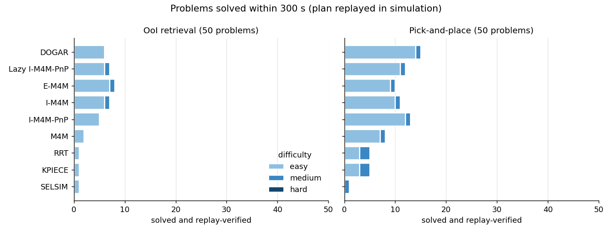
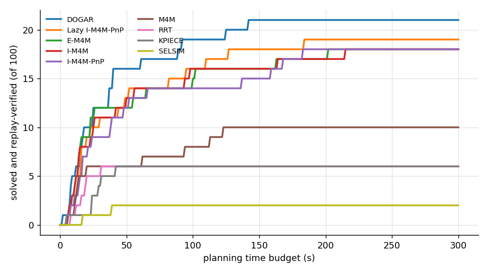

# Overnight run 4: every baseline as in its paper, judged on grid states

Experiment `workspace/experiments/20261028-145519_overnight4`; dataset `overnight4` (100 problems); 9 methods, one seed, at most 300 s of planning per run, 900 runs. A run counts as solved only if its plan, replayed from the initial scene in MuJoCo, succeeds (the OoI is out of its shelf / every target is at its goal).

**Most problems solved: DOGAR, 21 of 100.**

## Solved per method and task

| Method | OoI retrieval | Pick-and-place | Total |
|---|---|---|---|
| DOGAR | 6/50 | 15/50 | **21/100** |
| Lazy I-M4M-PnP | 7/50 | 12/50 | **19/100** |
| E-M4M | 8/50 | 10/50 | **18/100** |
| I-M4M | 7/50 | 11/50 | **18/100** |
| I-M4M-PnP | 5/50 | 13/50 | **18/100** |
| M4M | 2/50 | 8/50 | **10/100** |
| RRT | 1/50 | 5/50 | **6/100** |
| KPIECE | 1/50 | 5/50 | **6/100** |
| SELSIM | 1/50 | 1/50 | **2/100** |

## Solved per method and difficulty (both tasks)

| Method | easy | medium | hard | Total |
|---|---|---|---|---|
| DOGAR | 20/50 | 1/30 | 0/20 | **21/100** |
| Lazy I-M4M-PnP | 17/50 | 2/30 | 0/20 | **19/100** |
| E-M4M | 16/50 | 2/30 | 0/20 | **18/100** |
| I-M4M | 16/50 | 2/30 | 0/20 | **18/100** |
| I-M4M-PnP | 17/50 | 1/30 | 0/20 | **18/100** |
| M4M | 9/50 | 1/30 | 0/20 | **10/100** |
| RRT | 4/50 | 2/30 | 0/20 | **6/100** |
| KPIECE | 4/50 | 2/30 | 0/20 | **6/100** |
| SELSIM | 1/50 | 1/30 | 0/20 | **2/100** |

## OoI retrieval: per difficulty

| Method | easy | medium | hard | Total |
|---|---|---|---|---|
| DOGAR | 6/25 | 0/15 | 0/10 | **6/50** |
| Lazy I-M4M-PnP | 6/25 | 1/15 | 0/10 | **7/50** |
| E-M4M | 7/25 | 1/15 | 0/10 | **8/50** |
| I-M4M | 6/25 | 1/15 | 0/10 | **7/50** |
| I-M4M-PnP | 5/25 | 0/15 | 0/10 | **5/50** |
| M4M | 2/25 | 0/15 | 0/10 | **2/50** |
| RRT | 1/25 | 0/15 | 0/10 | **1/50** |
| KPIECE | 1/25 | 0/15 | 0/10 | **1/50** |
| SELSIM | 1/25 | 0/15 | 0/10 | **1/50** |

## Pick-and-place: per difficulty

| Method | easy | medium | hard | Total |
|---|---|---|---|---|
| DOGAR | 14/25 | 1/15 | 0/10 | **15/50** |
| Lazy I-M4M-PnP | 11/25 | 1/15 | 0/10 | **12/50** |
| E-M4M | 9/25 | 1/15 | 0/10 | **10/50** |
| I-M4M | 10/25 | 1/15 | 0/10 | **11/50** |
| I-M4M-PnP | 12/25 | 1/15 | 0/10 | **13/50** |
| M4M | 7/25 | 1/15 | 0/10 | **8/50** |
| RRT | 3/25 | 2/15 | 0/10 | **5/50** |
| KPIECE | 3/25 | 2/15 | 0/10 | **5/50** |
| SELSIM | 0/25 | 1/15 | 0/10 | **1/50** |

## Solved per environment (both tasks)

| Method | access19 | confined_shelf | multi_level_shelf | open_tabletop | stacking | Total |
|---|---|---|---|---|---|---|
| DOGAR | 1/21 | 7/20 | 5/20 | 5/19 | 3/20 | **21/100** |
| Lazy I-M4M-PnP | 1/21 | 9/20 | 2/20 | 4/19 | 3/20 | **19/100** |
| E-M4M | 0/21 | 8/20 | 3/20 | 1/19 | 6/20 | **18/100** |
| I-M4M | 0/21 | 7/20 | 3/20 | 1/19 | 7/20 | **18/100** |
| I-M4M-PnP | 0/21 | 8/20 | 2/20 | 5/19 | 3/20 | **18/100** |
| M4M | 0/21 | 6/20 | 2/20 | 1/19 | 1/20 | **10/100** |
| RRT | 0/21 | 0/20 | 0/20 | 3/19 | 3/20 | **6/100** |
| KPIECE | 0/21 | 0/20 | 0/20 | 3/19 | 3/20 | **6/100** |
| SELSIM | 0/21 | 0/20 | 0/20 | 0/19 | 2/20 | **2/100** |

## Planning time of the solved runs

| Method | median (s) | mean (s) | solved within 60 s | within 120 s | within 300 s |
|---|---|---|---|---|---|
| DOGAR | 24.2 | 38.8 | 16 | 19 | 21 |
| Lazy I-M4M-PnP | 22.5 | 47.6 | 14 | 17 | 19 |
| E-M4M | 18.8 | 47.4 | 13 | 16 | 18 |
| I-M4M | 23.3 | 48.3 | 14 | 16 | 18 |
| I-M4M-PnP | 30.8 | 56.4 | 13 | 14 | 18 |
| M4M | 16.1 | 46.2 | 6 | 9 | 10 |
| RRT | 16.8 | 17.1 | 6 | 6 | 6 |
| KPIECE | 26.0 | 25.2 | 6 | 6 | 6 |
| SELSIM | 27.5 | 27.5 | 2 | 2 | 2 |

## Why runs failed

| Method | reason | runs |
|---|---|---|
| DOGAR | budget exhausted | 51 |
| DOGAR | budget exhausted  | 4 |
| DOGAR | replay failed: push 1/1 invalid on replay: off the grid: object 7 outside the grid's  | 2 |
| DOGAR | replay failed: push 1/1 invalid on replay: immovable contact: obj / obj | 1 |
| DOGAR | replay failed: push 1/1 invalid on replay: off the grid: object 9 turned 34 deg off t | 1 |
| DOGAR | replay failed: push 2/2 invalid on replay: off the grid: object 10 turned 38 deg off  | 1 |
| Lazy I-M4M-PnP | budget exhausted | 48 |
| Lazy I-M4M-PnP | OPEN exhausted | 17 |
| Lazy I-M4M-PnP | budget exhausted  | 2 |
| Lazy I-M4M-PnP | replay failed: push 1/2 invalid on replay: off the grid: object 10 turned 45 deg off  | 2 |
| Lazy I-M4M-PnP | no retrieval trajectory without movables | 1 |
| Lazy I-M4M-PnP | replay failed: push 1/3 invalid on replay: off the grid: object 10 outside the grid's | 1 |
| E-M4M | OPEN exhausted | 46 |
| E-M4M | budget exhausted | 27 |
| E-M4M | no retrieval trajectory without movables | 1 |
| E-M4M | replay failed: push 1/1 invalid on replay: off the grid: object 10 turned 29 deg off  | 1 |
| E-M4M | replay failed: push 1/1 invalid on replay: off the grid: object 6 turned 20 deg off t | 1 |
| E-M4M | replay failed: push 1/1 invalid on replay: off the grid: object 10 turned 26 deg off  | 1 |
| I-M4M | OPEN exhausted | 48 |
| I-M4M | budget exhausted | 22 |
| I-M4M | no retrieval trajectory without movables | 1 |
| I-M4M | replay failed: push 1/1 invalid on replay: off the grid: object 10 turned 29 deg off  | 1 |
| I-M4M | replay failed: push 1/1 invalid on replay: off the grid: object 6 turned 20 deg off t | 1 |
| I-M4M | budget exhausted  | 1 |
| I-M4M-PnP | budget exhausted | 45 |
| I-M4M-PnP | OPEN exhausted | 20 |
| I-M4M-PnP | no retrieval trajectory without movables | 2 |
| I-M4M-PnP | replay failed: push 1/4 invalid on replay: off the grid: object 11 turned 44 deg off  | 1 |
| I-M4M-PnP | replay failed: push 1/5 invalid on replay: off the grid: object 7 outside the grid's  | 1 |
| I-M4M-PnP | replay failed: push 1/1 invalid on replay: off the grid: object 10 outside the grid's | 1 |
| M4M | budget exhausted | 47 |
| M4M | no MAPF-suggested push left | 27 |
| M4M | CBS failed | 8 |
| M4M | no retrieval trajectory without movables | 1 |
| M4M | replay failed: push 1/2 invalid on replay: off the grid: object 8 turned 32 deg off t | 1 |
| M4M | replay failed: retrieval segment 'lift': object 7 tilted 90 deg | 1 |
| RRT | budget exhausted | 93 |
| RRT | no grasp for the OoI | 1 |
| KPIECE | budget exhausted | 93 |
| KPIECE | no grasp for the OoI | 1 |
| SELSIM | budget exhausted | 90 |
| SELSIM | tracking failed, no irrelevant object to blame: robot hit shelf: sh | 4 |
| SELSIM | no grasp for the OoI | 1 |
| SELSIM | tracking failed, no irrelevant object to blame: bodies forced into  | 1 |
| SELSIM | tracking failed, no irrelevant object to blame: grasp failed: the fingers do not both touc | 1 |
| SELSIM | tracking failed, no irrelevant object to blame: pick-and-place: gra | 1 |

## Feasibility of the problems

From `scripts/feasibility.py` (`dataset/feasibility.csv`): **feasible** = some method (a baseline or the oracle witness search, `mamo/oracle`) found a plan that replays successfully with the current simulator; **infeasible** = a necessary condition fails (the target cannot be retrieved / picked and placed in simulation even with every movable removed, 20 seeds, or the free surface is too small); **unknown** = neither.

| Task | Difficulty | feasible | infeasible | unknown |
|---|---|---|---|---|
| OoI retrieval | easy | 22 | 0 | 3 |
| OoI retrieval | medium | 8 | 0 | 7 |
| OoI retrieval | hard | 0 | 0 | 10 |
| Pick-and-place | easy | 22 | 1 | 2 |
| Pick-and-place | medium | 6 | 0 | 9 |
| Pick-and-place | hard | 0 | 3 | 7 |

Solved (replay-verified) of the 58 problems known to be feasible:

| Method | solved | of feasible |
|---|---|---|
| DOGAR | 21 | 36% |
| Lazy I-M4M-PnP | 19 | 33% |
| E-M4M | 18 | 31% |
| I-M4M | 18 | 31% |
| I-M4M-PnP | 18 | 31% |
| M4M | 10 | 17% |
| RRT | 6 | 10% |
| KPIECE | 6 | 10% |
| SELSIM | 2 | 3% |

## Notes

**What changed since overnight3.** Same 100 problems (the `overnight4` dataset is a copy of `overnight3`), same budget (300 s for every method), load (8 runs in parallel) and friction (0.8). Every planner now runs as its paper describes it (decided 2026-10-28: "run everything as per their papers only"). The planners plan with continuous states and know nothing of the grid (`grid.planners = False`):

* CBS push goals are every free 1 cm lattice point outside the NGR, not just points near cell centres
* pick-and-places use any of the 8 placement yaws
* no grid check while planning, including RRT / KPIECE / SELSIM's goal test
* SELSIM's RELEVANTOBJECT is the paper's BFS from the violated object only; the robot-rooted fallback is gone

The grid is the problem's rule and is judged when the plan is replayed: every push and pick-and-place, and the final state, must leave each object in a cell of its own. DOGAR (2011) already ran this way in overnight3. Only the paper methods run; the [ext] DOGAR variants and the oracle do not.

**Solved and replayed, overnight3 (grid-aware planners) vs overnight4 (paper planners, grid judged at replay):**

| Method | overnight3 retrieval / pick-and-place / total | overnight4 retrieval / pick-and-place / total |
|---|---|---|
| DOGAR (2011) | 6 / 16 / 22 | 6 / 15 / **21** |
| Lazy I-M4M-PnP | 16 / 20 / 36 | 7 / 12 / **19** |
| E-M4M | 6 / 8 / 14 | 8 / 10 / **18** |
| I-M4M | 6 / 11 / 17 | 7 / 11 / **18** |
| I-M4M-PnP | 17 / 18 / 35 | 5 / 13 / **18** |
| M4M | 9 / 9 / 18 | 2 / 8 / **10** |
| RRT | 1 / 4 / 5 | 1 / 5 / **6** |
| KPIECE | 1 / 4 / 5 | 1 / 5 / **6** |
| SELSIM | 1 / 1 / 2 | 1 / 1 / **2** |

**OoI retrieval: plans found vs plans that replay on the grid (overnight3 -> overnight4):**

| Method | planned | replayed | replay failures, overnight4 |
|---|---|---|---|
| M4M | 10 -> 8 | 9 -> 2 | 3 box turned, 2 two objects in one cell, 1 other |
| E-M4M | 6 -> 16 | 6 -> 8 | 7 box turned, 1 out of its cell |
| I-M4M | 6 -> 17 | 6 -> 7 | 7 box turned, 2 out of its cell, 1 other |
| I-M4M-PnP | 19 -> 20 | 17 -> 5 | 9 box turned, 5 out of its cell, 1 other |
| Lazy I-M4M-PnP | 17 -> 20 | 16 -> 7 | 8 box turned, 5 out of its cell |
| DOGAR | 28 -> 28 | 6 -> 6 | 16 box turned, 2 out of its cell, 4 other |

* **Without the grid, E-M4M and I-M4M find almost three times as many retrieval plans (6 -> 16-17).** Their CBS goals are no longer limited to 9 lattice points per cell, so far fewer runs end with "OPEN exhausted" (38 -> 27 of 50 retrieval runs). This is the effect explained after overnight3: each failed push invalidates its goal, and with few goals per cell the search ran out.
* **Half of those plans fail the grid at replay.** The pushes leave a box turned 15-45 deg or between cells: nothing in the papers' planners keeps objects square. On balance E-M4M gains 4 problems and I-M4M 1.
* **I-M4M-PnP and Lazy I-M4M-PnP lose about half their solves (35-36 -> 18-19).** Their pick-and-places now aim at any free point with any of 8 yaws. 14 and 13 of their retrieval plans put a box down turned or between cells. In overnight3 they aimed at cell centres and turned boxes only by 90 deg.
* **M4M drops from 18 to 10.** 6 of its 8 retrieval plans fail at replay (a box turned, or two objects pushed into one cell).
* **DOGAR is unchanged** (22 -> 21; 21 problems in common). Its planner was already the paper's; one pick-and-place problem was not solved again.
* **Pick-and-place problems hold up better for every push method.** Each stage is replayed on the grid before the next. A stage that fails is planned again from the same state while the budget lasts (stage re-plans: E-M4M 34, I-M4M 35, I-M4M-PnP 70, Lazy 55, DOGAR 249). So a method keeps trying until a stage happens to land on the grid.
* **RRT, KPIECE and SELSIM barely change.** Their states were continuous in overnight3 too; only their goal test no longer checks the grid. RRT and KPIECE each gain one pick-and-place problem.
* **SELSIM without the robot-rooted BFS.** 7 of its runs ended with "tracking failed, no irrelevant object to blame". In those runs the robot touched the shelf, or the grasp failed, and the paper's RELEVANTOBJECT has no object to start from. It still solves the same 2 problems.
* **No method solves a hard problem**, as in overnight2 and overnight3.
* **Problem coverage.** Together the methods solve 36 problems, against 49 in overnight3; no problem is solved only in overnight4.

**Feasibility (`dataset/feasibility.csv`).** The labels are 58 feasible, 4 infeasible and 38 unknown, unchanged from overnight3. The witnesses are this run's replayed plans plus every earlier plan that replays under the grid: overnight3's runs, its oracle, and the overnight2 plans and oracle (`revalidation_grid.json`). overnight4 adds no new witness.

**Repro.** `python scripts/overnight4_pipeline.py --workers 8 --budget 300` (resumes from `pipeline_state.json`). The experiment is `workspace/experiments/20261028-145519_overnight4`. The overnight, overnight2 and overnight3 results are unchanged. Reproducing overnight3 needs `grid.planners = True`.

## Files

* `results.csv`: one row per run
* `<baseline>/results.csv`, `<baseline>/solutions/<task>/*.pkl` (plans, `mamo.solution.Solution`), `<baseline>/gifs/<task>/*.gif` (every solved run replayed, iso and top view)
* `dataset/`: the problems (scene files), `dataset/labels.csv` their labels, `dataset/index.html` a gallery of every problem (`dataset/gifs/<task>/<env>/<scene>.gif` and top views)
