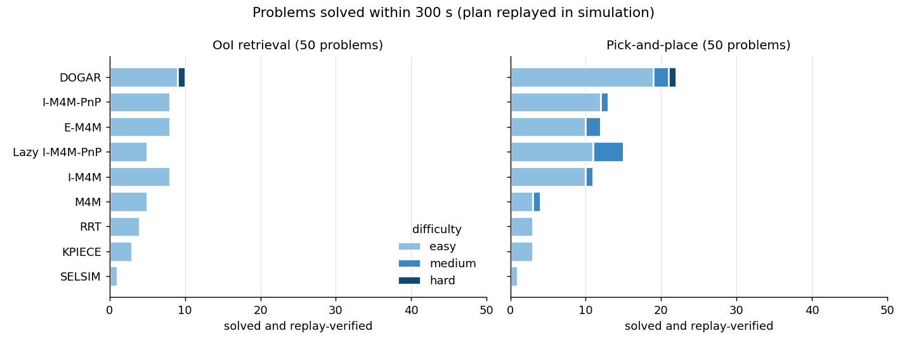
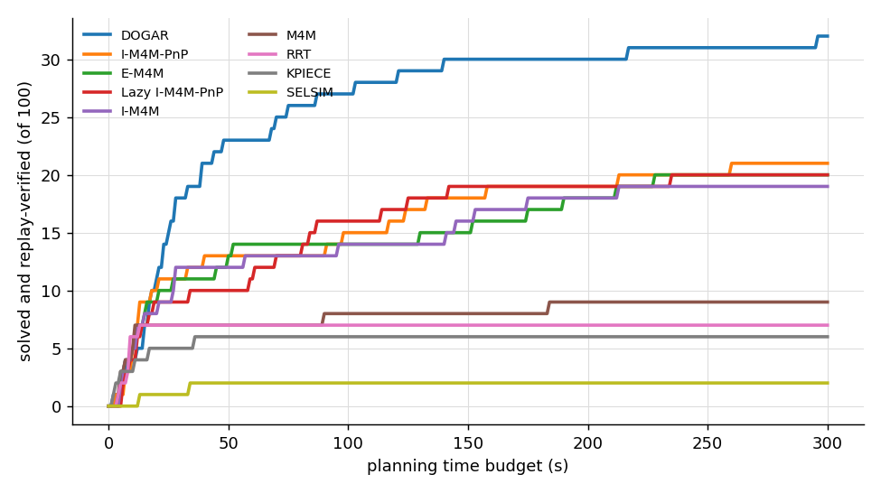

# Overnight run 5: every baseline as in its paper, easier dataset, grid states

Experiment `workspace/experiments/20261028-230621_overnight5`; dataset `overnight5-grid` (100 problems); 9 methods, one seed, at most 300 s of planning per run, 900 runs. A run counts as solved only if its plan, replayed from the initial scene in MuJoCo, succeeds (the OoI is out of its shelf / every target is at its goal).

**Most problems solved: DOGAR, 32 of 100.**

## Solved per method and task

| Method | OoI retrieval | Pick-and-place | Total |
|---|---|---|---|
| DOGAR | 10/50 | 22/50 | **32/100** |
| I-M4M-PnP | 8/50 | 13/50 | **21/100** |
| E-M4M | 8/50 | 12/50 | **20/100** |
| Lazy I-M4M-PnP | 5/50 | 15/50 | **20/100** |
| I-M4M | 8/50 | 11/50 | **19/100** |
| M4M | 5/50 | 4/50 | **9/100** |
| RRT | 4/50 | 3/50 | **7/100** |
| KPIECE | 3/50 | 3/50 | **6/100** |
| SELSIM | 1/50 | 1/50 | **2/100** |

## Solved per method and difficulty (both tasks)

| Method | easy | medium | hard | Total |
|---|---|---|---|---|
| DOGAR | 28/50 | 2/30 | 2/20 | **32/100** |
| I-M4M-PnP | 20/50 | 1/30 | 0/20 | **21/100** |
| E-M4M | 18/50 | 2/30 | 0/20 | **20/100** |
| Lazy I-M4M-PnP | 16/50 | 4/30 | 0/20 | **20/100** |
| I-M4M | 18/50 | 1/30 | 0/20 | **19/100** |
| M4M | 8/50 | 1/30 | 0/20 | **9/100** |
| RRT | 7/50 | 0/30 | 0/20 | **7/100** |
| KPIECE | 6/50 | 0/30 | 0/20 | **6/100** |
| SELSIM | 2/50 | 0/30 | 0/20 | **2/100** |

## OoI retrieval: per difficulty

| Method | easy | medium | hard | Total |
|---|---|---|---|---|
| DOGAR | 9/25 | 0/15 | 1/10 | **10/50** |
| I-M4M-PnP | 8/25 | 0/15 | 0/10 | **8/50** |
| E-M4M | 8/25 | 0/15 | 0/10 | **8/50** |
| Lazy I-M4M-PnP | 5/25 | 0/15 | 0/10 | **5/50** |
| I-M4M | 8/25 | 0/15 | 0/10 | **8/50** |
| M4M | 5/25 | 0/15 | 0/10 | **5/50** |
| RRT | 4/25 | 0/15 | 0/10 | **4/50** |
| KPIECE | 3/25 | 0/15 | 0/10 | **3/50** |
| SELSIM | 1/25 | 0/15 | 0/10 | **1/50** |

## Pick-and-place: per difficulty

| Method | easy | medium | hard | Total |
|---|---|---|---|---|
| DOGAR | 19/25 | 2/15 | 1/10 | **22/50** |
| I-M4M-PnP | 12/25 | 1/15 | 0/10 | **13/50** |
| E-M4M | 10/25 | 2/15 | 0/10 | **12/50** |
| Lazy I-M4M-PnP | 11/25 | 4/15 | 0/10 | **15/50** |
| I-M4M | 10/25 | 1/15 | 0/10 | **11/50** |
| M4M | 3/25 | 1/15 | 0/10 | **4/50** |
| RRT | 3/25 | 0/15 | 0/10 | **3/50** |
| KPIECE | 3/25 | 0/15 | 0/10 | **3/50** |
| SELSIM | 1/25 | 0/15 | 0/10 | **1/50** |

## Solved per environment (both tasks)

| Method | confined_shelf | multi_level_shelf | open_tabletop | stacking | Total |
|---|---|---|---|---|---|
| DOGAR | 7/28 | 8/24 | 9/26 | 8/22 | **32/100** |
| I-M4M-PnP | 6/28 | 4/24 | 7/26 | 4/22 | **21/100** |
| E-M4M | 5/28 | 5/24 | 1/26 | 9/22 | **20/100** |
| Lazy I-M4M-PnP | 6/28 | 4/24 | 6/26 | 4/22 | **20/100** |
| I-M4M | 5/28 | 5/24 | 1/26 | 8/22 | **19/100** |
| M4M | 6/28 | 2/24 | 1/26 | 0/22 | **9/100** |
| RRT | 0/28 | 1/24 | 1/26 | 5/22 | **7/100** |
| KPIECE | 0/28 | 0/24 | 1/26 | 5/22 | **6/100** |
| SELSIM | 0/28 | 0/24 | 0/26 | 2/22 | **2/100** |

## Planning time of the solved runs

| Method | median (s) | mean (s) | solved within 60 s | within 120 s | within 300 s |
|---|---|---|---|---|---|
| DOGAR | 26.6 | 52.4 | 23 | 28 | 32 |
| I-M4M-PnP | 20.4 | 65.8 | 13 | 16 | 21 |
| E-M4M | 23.7 | 68.0 | 14 | 14 | 20 |
| Lazy I-M4M-PnP | 46.2 | 59.2 | 11 | 17 | 20 |
| I-M4M | 26.2 | 60.2 | 13 | 14 | 19 |
| M4M | 9.2 | 35.9 | 7 | 8 | 9 |
| RRT | 8.4 | 7.9 | 7 | 7 | 7 |
| KPIECE | 7.5 | 11.9 | 6 | 6 | 6 |
| SELSIM | 22.8 | 22.8 | 2 | 2 | 2 |

## Why runs failed

| Method | reason | runs |
|---|---|---|
| DOGAR | budget exhausted | 42 |
| DOGAR | budget exhausted  | 4 |
| DOGAR | replay failed: push 1/1 invalid on replay: off the grid: object 10 turned 38 deg off  | 2 |
| DOGAR | replay failed: push 1/2 invalid on replay: off the grid: object 11 turned 39 deg off  | 2 |
| DOGAR | replay failed: push 1/1 invalid on replay: off the grid: object 6 turned 38 deg off t | 1 |
| DOGAR | replay failed: push 1/1 invalid on replay: off the grid: object 10 turned 39 deg off  | 1 |
| I-M4M-PnP | budget exhausted | 54 |
| I-M4M-PnP | OPEN exhausted | 8 |
| I-M4M-PnP | no retrieval trajectory without movables | 2 |
| I-M4M-PnP | replay failed: push 1/5 invalid on replay: off the grid: object 11 turned 44 deg off  | 1 |
| I-M4M-PnP | replay failed: push 1/1 invalid on replay: bodies forced into each other (x cm): sh | 1 |
| I-M4M-PnP | replay failed: push 1/2 invalid on replay: off the grid: object 10 turned 44 deg off  | 1 |
| E-M4M | OPEN exhausted | 36 |
| E-M4M | budget exhausted | 30 |
| E-M4M | no retrieval trajectory without movables | 2 |
| E-M4M | replay failed: push 7/8 invalid on replay: off the grid: object 8 outside the grid's  | 1 |
| E-M4M | replay failed: push 1/3 invalid on replay: off the grid: object 10 outside the grid's | 1 |
| E-M4M | replay failed: push 1/2 invalid on replay: off the grid: object 10 turned 44 deg off  | 1 |
| Lazy I-M4M-PnP | budget exhausted | 52 |
| Lazy I-M4M-PnP | OPEN exhausted | 8 |
| Lazy I-M4M-PnP | replay failed: push 1/1 invalid on replay: off the grid: object 6 outside the grid's  | 2 |
| Lazy I-M4M-PnP | no retrieval trajectory without movables | 2 |
| Lazy I-M4M-PnP | replay failed: push 1/1 invalid on replay: off the grid: object 6 turned 28 deg off t | 1 |
| Lazy I-M4M-PnP | replay failed: push 1/1 invalid on replay: bodies forced into each other (x cm): sh | 1 |
| I-M4M | OPEN exhausted | 37 |
| I-M4M | budget exhausted | 27 |
| I-M4M | no retrieval trajectory without movables | 2 |
| I-M4M | replay failed: push 1/2 invalid on replay: off the grid: object 10 turned 35 deg off  | 1 |
| I-M4M | replay failed: push 1/2 invalid on replay: off the grid: object 10 turned 34 deg off  | 1 |
| I-M4M | replay failed: push 1/1 invalid on replay: off the grid: object 6 turned 34 deg off t | 1 |
| M4M | budget exhausted | 53 |
| M4M | no MAPF-suggested push left | 25 |
| M4M | no retrieval trajectory without movables | 2 |
| M4M | replay failed: push 2/2 invalid on replay: off the grid: object 7 outside the grid's  | 1 |
| M4M | replay failed: push 1/2 invalid on replay: off the grid: object 10 turned 27 deg off  | 1 |
| M4M | replay failed: push 1/2 invalid on replay: off the grid: object 10 outside the grid's | 1 |
| RRT | budget exhausted | 91 |
| RRT | no grasp for the OoI | 2 |
| KPIECE | budget exhausted | 91 |
| KPIECE | no grasp for the OoI | 2 |
| KPIECE | replay failed: off the grid: object 10 turned 21 deg off the grid | 1 |
| SELSIM | budget exhausted | 82 |
| SELSIM | tracking failed, no irrelevant object to blame: robot hit shelf: sh | 6 |
| SELSIM | tracking failed, no irrelevant object to blame: pick-and-place: gra | 3 |
| SELSIM | tracking failed, no irrelevant object to blame: retrieval segment 'lift': object 6 tilted  | 2 |
| SELSIM | no grasp for the OoI | 2 |
| SELSIM | replay failed: retrieval segment 'reach': object 10 tilted 25 deg | 1 |

## Feasibility of the problems

From `scripts/feasibility.py` (`dataset/feasibility.csv`): **feasible** = some method (a baseline or the oracle witness search, `mamo/oracle`) found a plan that replays successfully with the current simulator; **infeasible** = a necessary condition fails (the target cannot be retrieved / picked and placed in simulation even with every movable removed, 20 seeds, or the free surface is too small); **unknown** = neither.

| Task | Difficulty | feasible | infeasible | unknown |
|---|---|---|---|---|
| OoI retrieval | easy | 20 | 0 | 5 |
| OoI retrieval | medium | 0 | 0 | 15 |
| OoI retrieval | hard | 1 | 0 | 9 |
| Pick-and-place | easy | 22 | 1 | 2 |
| Pick-and-place | medium | 5 | 0 | 10 |
| Pick-and-place | hard | 1 | 1 | 8 |

Solved (replay-verified) of the 49 problems known to be feasible:

| Method | solved | of feasible |
|---|---|---|
| DOGAR | 32 | 65% |
| I-M4M-PnP | 21 | 43% |
| E-M4M | 20 | 41% |
| Lazy I-M4M-PnP | 20 | 41% |
| I-M4M | 19 | 39% |
| M4M | 9 | 18% |
| RRT | 7 | 14% |
| KPIECE | 6 | 12% |
| SELSIM | 2 | 4% |

## Notes

**The run.** This is overnight run 5, with the same setup as `../overnight5-nogrid/notes.md`: the 9 paper methods, planners as in their papers (`grid.planners = False`), 300 s per run, 8 runs in parallel, friction 0.8, and one experiment interleaving both datasets (`workspace/experiments/20261028-230621_overnight5`). The dataset `overnight5-grid` holds the same 100 scheme-v2 problems as the no-grid copy. Here the grid rule is on and is judged at replay. Every push and pick-and-place, and the final state, must leave each object squarely in a cell of its own.

**Solved and replayed: grid vs the same problems without the grid, and overnight4 (old, harder dataset, grid):**

| Method | retrieval | pick-and-place | easy | medium | hard | total | no grid | overnight4 |
|---|---|---|---|---|---|---|---|---|
| DOGAR (2011) | 10 | 22 | 28 | 2 | 2 | **32** | 55 | 21 |
| I-M4M-PnP | 8 | 13 | 20 | 1 | 0 | **21** | 46 | 18 |
| E-M4M | 8 | 12 | 18 | 2 | 0 | **20** | 34 | 18 |
| Lazy I-M4M-PnP | 5 | 15 | 16 | 4 | 0 | **20** | 42 | 19 |
| I-M4M | 8 | 11 | 18 | 1 | 0 | **19** | 39 | 18 |
| M4M | 5 | 4 | 8 | 1 | 0 | **9** | 28 | 10 |
| RRT | 4 | 3 | 7 | 0 | 0 | **7** | 8 | 6 |
| KPIECE | 3 | 3 | 6 | 0 | 0 | **6** | 9 | 6 |
| SELSIM | 1 | 1 | 2 | 0 | 0 | **2** | 2 | 2 |

**Plans found vs plans that replay on the grid** (no grid in brackets):

| Method | planned | replayed |
|---|---|---|
| DOGAR | 54 (58) | 32 (55) |
| I-M4M-PnP | 36 (48) | 21 (46) |
| Lazy I-M4M-PnP | 37 (45) | 20 (42) |
| I-M4M | 33 (43) | 19 (39) |
| E-M4M | 32 (37) | 20 (34) |
| M4M | 20 (30) | 9 (28) |

* **The grid costs every push-based method 40-70 % of its solves.** The planners find almost as many plans as without the grid. They find fewer only in pick-and-place problems, where a stage that fails on the grid is re-planned and uses up budget. About 40 % of the plans then fail replay because a push leaves a box turned 20-45 deg or between cells. None of the papers' planners keeps objects square.
* **The easier dataset barely helps under the grid.** Totals are close to overnight4 (DOGAR 21 -> 32, the M4M family about the same). Without the grid, the same problems give 28-55.
* **Ranking:** DOGAR first, then the I-M4M variants and E-M4M close together (19-21), then M4M (9). The grid flattens the papers' order of the M4M family, and the no-grid copy restores it.
* **Medium and hard:** at most 4 of 30 medium and 2 of 20 hard problems are solved.
* **Coverage:** together the methods solve 49 problems, against 73 without the grid. Every problem solved here is also solved without the grid.

**Feasibility (`dataset/feasibility.csv`).** 49 feasible, 2 infeasible and 49 unknown. The witnesses are this run's replayed plans; no oracle was run.

**Repro.** `python scripts/overnight5_pipeline.py --workers 8 --budget 300`. Earlier overnight results are unchanged.

## Files

* `results.csv`: one row per run
* `<baseline>/results.csv`, `<baseline>/solutions/<task>/*.pkl` (plans, `mamo.solution.Solution`), `<baseline>/gifs/<task>/*.gif` (every solved run replayed, iso and top view)
* `dataset/`: the problems (scene files), `dataset/labels.csv` their labels, `dataset/index.html` a gallery of every problem (`dataset/gifs/<task>/<env>/<scene>.gif` and top views)
