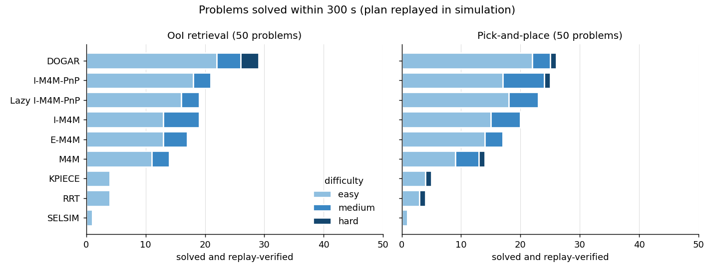
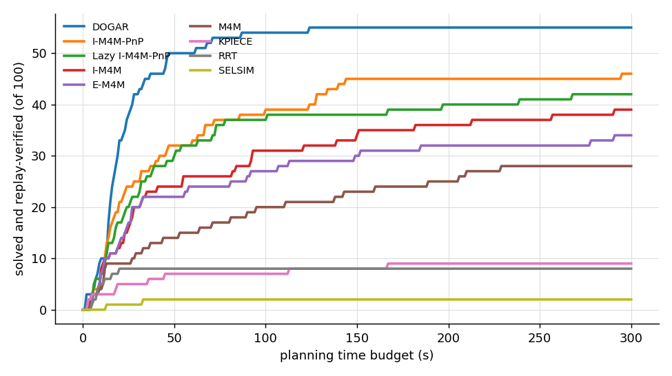

# Overnight run 5: every baseline as in its paper, easier dataset, continuous states

Experiment `workspace/experiments/20261028-230621_overnight5`; dataset `overnight5-nogrid` (100 problems); 9 methods, one seed, at most 300 s of planning per run, 900 runs. A run counts as solved only if its plan, replayed from the initial scene in MuJoCo, succeeds (the OoI is out of its shelf / every target is at its goal).

**Most problems solved: DOGAR, 55 of 100.**

## Solved per method and task

| Method | OoI retrieval | Pick-and-place | Total |
|---|---|---|---|
| DOGAR | 29/50 | 26/50 | **55/100** |
| I-M4M-PnP | 21/50 | 25/50 | **46/100** |
| Lazy I-M4M-PnP | 19/50 | 23/50 | **42/100** |
| I-M4M | 19/50 | 20/50 | **39/100** |
| E-M4M | 17/50 | 17/50 | **34/100** |
| M4M | 14/50 | 14/50 | **28/100** |
| KPIECE | 4/50 | 5/50 | **9/100** |
| RRT | 4/50 | 4/50 | **8/100** |
| SELSIM | 1/50 | 1/50 | **2/100** |

## Solved per method and difficulty (both tasks)

| Method | easy | medium | hard | Total |
|---|---|---|---|---|
| DOGAR | 44/50 | 7/30 | 4/20 | **55/100** |
| I-M4M-PnP | 35/50 | 10/30 | 1/20 | **46/100** |
| Lazy I-M4M-PnP | 34/50 | 8/30 | 0/20 | **42/100** |
| I-M4M | 28/50 | 11/30 | 0/20 | **39/100** |
| E-M4M | 27/50 | 7/30 | 0/20 | **34/100** |
| M4M | 20/50 | 7/30 | 1/20 | **28/100** |
| KPIECE | 8/50 | 0/30 | 1/20 | **9/100** |
| RRT | 7/50 | 0/30 | 1/20 | **8/100** |
| SELSIM | 2/50 | 0/30 | 0/20 | **2/100** |

## OoI retrieval: per difficulty

| Method | easy | medium | hard | Total |
|---|---|---|---|---|
| DOGAR | 22/25 | 4/15 | 3/10 | **29/50** |
| I-M4M-PnP | 18/25 | 3/15 | 0/10 | **21/50** |
| Lazy I-M4M-PnP | 16/25 | 3/15 | 0/10 | **19/50** |
| I-M4M | 13/25 | 6/15 | 0/10 | **19/50** |
| E-M4M | 13/25 | 4/15 | 0/10 | **17/50** |
| M4M | 11/25 | 3/15 | 0/10 | **14/50** |
| KPIECE | 4/25 | 0/15 | 0/10 | **4/50** |
| RRT | 4/25 | 0/15 | 0/10 | **4/50** |
| SELSIM | 1/25 | 0/15 | 0/10 | **1/50** |

## Pick-and-place: per difficulty

| Method | easy | medium | hard | Total |
|---|---|---|---|---|
| DOGAR | 22/25 | 3/15 | 1/10 | **26/50** |
| I-M4M-PnP | 17/25 | 7/15 | 1/10 | **25/50** |
| Lazy I-M4M-PnP | 18/25 | 5/15 | 0/10 | **23/50** |
| I-M4M | 15/25 | 5/15 | 0/10 | **20/50** |
| E-M4M | 14/25 | 3/15 | 0/10 | **17/50** |
| M4M | 9/25 | 4/15 | 1/10 | **14/50** |
| KPIECE | 4/25 | 0/15 | 1/10 | **5/50** |
| RRT | 3/25 | 0/15 | 1/10 | **4/50** |
| SELSIM | 1/25 | 0/15 | 0/10 | **1/50** |

## Solved per environment (both tasks)

| Method | confined_shelf | multi_level_shelf | open_tabletop | stacking | Total |
|---|---|---|---|---|---|
| DOGAR | 15/28 | 15/24 | 9/26 | 16/22 | **55/100** |
| I-M4M-PnP | 12/28 | 17/24 | 8/26 | 9/22 | **46/100** |
| Lazy I-M4M-PnP | 10/28 | 14/24 | 7/26 | 11/22 | **42/100** |
| I-M4M | 6/28 | 15/24 | 1/26 | 17/22 | **39/100** |
| E-M4M | 6/28 | 14/24 | 1/26 | 13/22 | **34/100** |
| M4M | 8/28 | 12/24 | 1/26 | 7/22 | **28/100** |
| KPIECE | 0/28 | 2/24 | 2/26 | 5/22 | **9/100** |
| RRT | 0/28 | 1/24 | 2/26 | 5/22 | **8/100** |
| SELSIM | 0/28 | 0/24 | 0/26 | 2/22 | **2/100** |

## Planning time of the solved runs

| Method | median (s) | mean (s) | solved within 60 s | within 120 s | within 300 s |
|---|---|---|---|---|---|
| DOGAR | 17.5 | 24.9 | 50 | 54 | 55 |
| I-M4M-PnP | 23.0 | 48.1 | 33 | 39 | 46 |
| Lazy I-M4M-PnP | 25.7 | 48.4 | 32 | 38 | 42 |
| I-M4M | 27.4 | 64.2 | 26 | 31 | 39 |
| E-M4M | 25.4 | 59.4 | 24 | 29 | 34 |
| M4M | 48.1 | 74.2 | 15 | 21 | 28 |
| KPIECE | 18.6 | 45.0 | 7 | 8 | 9 |
| RRT | 8.2 | 10.1 | 8 | 8 | 8 |
| SELSIM | 22.5 | 22.5 | 2 | 2 | 2 |

## Why runs failed

| Method | reason | runs |
|---|---|---|
| DOGAR | budget exhausted | 42 |
| DOGAR | replay failed: push 1/2 invalid on replay: object 7 tilted 25 deg | 1 |
| DOGAR | replay failed: push 2/2 invalid on replay: immovable contact: obj / robot/right_fin | 1 |
| DOGAR | replay failed: push 1/1 invalid on replay: immovable contact: obj / obj | 1 |
| I-M4M-PnP | budget exhausted | 42 |
| I-M4M-PnP | OPEN exhausted | 8 |
| I-M4M-PnP | no retrieval trajectory without movables | 2 |
| I-M4M-PnP | replay failed: grasp failed: the fingers do not both touch the OoI | 1 |
| I-M4M-PnP | replay failed: push 1/1 invalid on replay: bodies forced into each other (x cm): sh | 1 |
| Lazy I-M4M-PnP | budget exhausted | 45 |
| Lazy I-M4M-PnP | OPEN exhausted | 8 |
| Lazy I-M4M-PnP | no retrieval trajectory without movables | 2 |
| Lazy I-M4M-PnP | replay failed: grasp failed: the fingers do not both touch the OoI | 1 |
| Lazy I-M4M-PnP | replay failed: push 3/3 invalid on replay: simulation unstable (MuJoCo reset the stat | 1 |
| Lazy I-M4M-PnP | replay failed: push 1/1 invalid on replay: bodies forced into each other (x cm): sh | 1 |
| I-M4M | OPEN exhausted | 36 |
| I-M4M | budget exhausted | 19 |
| I-M4M | replay failed: grasp failed: the fingers do not both touch the OoI | 2 |
| I-M4M | no retrieval trajectory without movables | 2 |
| I-M4M | replay failed: push 1/1 invalid on replay: object 7 tilted 25 deg | 1 |
| I-M4M | replay failed: push 2/2 invalid on replay: object 7 tilted 25 deg | 1 |
| E-M4M | OPEN exhausted | 35 |
| E-M4M | budget exhausted | 26 |
| E-M4M | no retrieval trajectory without movables | 2 |
| E-M4M | replay failed: grasp failed: the fingers do not both touch the OoI | 1 |
| E-M4M | replay failed: push 1/2 invalid on replay: object 7 tilted 25 deg | 1 |
| E-M4M | replay failed: push 2/2 invalid on replay: object 7 tilted 25 deg | 1 |
| M4M | budget exhausted | 50 |
| M4M | no MAPF-suggested push left | 18 |
| M4M | no retrieval trajectory without movables | 2 |
| M4M | replay failed: grasp failed: the fingers do not both touch the OoI | 2 |
| KPIECE | budget exhausted | 89 |
| KPIECE | no grasp for the OoI | 2 |
| RRT | budget exhausted | 90 |
| RRT | no grasp for the OoI | 2 |
| SELSIM | budget exhausted | 82 |
| SELSIM | tracking failed, no irrelevant object to blame: robot hit shelf: sh | 6 |
| SELSIM | tracking failed, no irrelevant object to blame: pick-and-place: gra | 3 |
| SELSIM | tracking failed, no irrelevant object to blame: retrieval segment 'lift': object 6 tilted  | 2 |
| SELSIM | no grasp for the OoI | 2 |
| SELSIM | replay failed: retrieval segment 'reach': object 10 tilted 25 deg | 1 |

## Feasibility of the problems

From `scripts/feasibility.py` (`dataset/feasibility.csv`): **feasible** = some method (a baseline or the oracle witness search, `mamo/oracle`) found a plan that replays successfully with the current simulator; **infeasible** = a necessary condition fails (the target cannot be retrieved / picked and placed in simulation even with every movable removed, 20 seeds, or the free surface is too small); **unknown** = neither.

| Task | Difficulty | feasible | infeasible | unknown |
|---|---|---|---|---|
| OoI retrieval | easy | 24 | 0 | 1 |
| OoI retrieval | medium | 8 | 0 | 7 |
| OoI retrieval | hard | 3 | 0 | 7 |
| Pick-and-place | easy | 24 | 1 | 0 |
| Pick-and-place | medium | 11 | 0 | 4 |
| Pick-and-place | hard | 3 | 1 | 6 |

Solved (replay-verified) of the 73 problems known to be feasible:

| Method | solved | of feasible |
|---|---|---|
| DOGAR | 55 | 75% |
| I-M4M-PnP | 46 | 63% |
| Lazy I-M4M-PnP | 42 | 58% |
| I-M4M | 39 | 53% |
| E-M4M | 34 | 47% |
| M4M | 28 | 38% |
| KPIECE | 9 | 12% |
| RRT | 8 | 11% |
| SELSIM | 2 | 3% |

## Notes

**The run.** Overnight run 5 (2026-10-28 23:06 to 2026-10-29 12:28). Every planner runs as its paper describes it (`grid.planners = False`), with 300 s per run, 8 runs in parallel, and friction 0.8. Only the 9 paper methods run. The dataset `overnight5-nogrid` uses scheme v2, an easier ladder (README, "Dataset scheme v2 and the twin datasets"). It has 100 problems: 25 / 15 / 10 easy / medium / hard per task, in 4 categories, with Access-19 merged into the confined shelf.

Its scene files are the same as `overnight5-grid`'s, except that `meta["grid"] = false` switches the grid rule off. States are continuous, as in the papers, and a replay is judged only by the interaction constraints. Both datasets ran in one experiment (`workspace/experiments/20261028-230621_overnight5`), interleaved, so both had the same load. The grid copy has its own notes in `../overnight5-grid/notes.md`.

**Solved and replayed:**

| Method | retrieval | pick-and-place | easy | medium | hard | total | same problems, grid |
|---|---|---|---|---|---|---|---|
| DOGAR (2011) | 29 | 26 | 44 | 7 | 4 | **55** | 32 |
| I-M4M-PnP | 21 | 25 | 35 | 10 | 1 | **46** | 21 |
| Lazy I-M4M-PnP | 19 | 23 | 34 | 8 | 0 | **42** | 20 |
| I-M4M | 19 | 20 | 28 | 11 | 0 | **39** | 19 |
| E-M4M | 17 | 17 | 27 | 7 | 0 | **34** | 20 |
| M4M | 14 | 14 | 20 | 7 | 1 | **28** | 9 |
| KPIECE | 4 | 5 | 8 | 0 | 1 | **9** | 6 |
| RRT | 4 | 4 | 7 | 0 | 1 | **8** | 7 |
| SELSIM | 1 | 1 | 2 | 0 | 0 | **2** | 2 |

* **Without the grid, the M4M family ranks as in its papers.** The order is M4M < E-M4M < I-M4M < I-M4M-PnP (28 < 34 < 39 < 46). Lazy I-M4M-PnP is close to I-M4M-PnP. Only the grid reversed this order in overnight3 and overnight4.
* **Plans replay.** Of 58 / 48 / 45 / 43 / 37 / 30 plans found (DOGAR / PnP / Lazy / I-M4M / E-M4M / M4M), 2-4 per method fail the replay, for a grasp miss, a tilt or immovable contact. Planning and replay agree.
* **The easier ladder works at easy and medium.** Easy problems are solved by 7 of 9 methods, and 44 of 50 by DOGAR. Hard is still nearly unsolved, at most 4 of 20. Together the methods solve 73 problems: 49 easy, 19 medium and 5 hard.
* **DOGAR is ahead, as in overnight3 and overnight4.** It is the planner of Dogar & Srinivasa's own paper, with push-grasps, sweeps and PickUps. Its 55 solutions use 79 pick-and-places and 34 pushes. The M4M papers instead compare against a re-implementation that only has M4M's push planner and random goals outside the NGR (`dogar_m4m`, [ext], not run here). That is why DOGAR is weak in those papers (M4M: 40 / 20 / 6 %, E-M4M: 7 / 0 / 0 solved).
* **The M4M family is limited by its push planner on the xArm7.** In the runs that failed, per run:

| Method | push planner | CBS | simulation | push trajectories planned | pushes simulated | of which invalid |
|---|---|---|---|---|---|---|
| M4M | 206 s | 0 s | 18 s | 486 | 26.9 | 26.0 |
| E-M4M | 114 s | 68 s | 15 s | 246 | 17.5 | 15.8 |
| I-M4M | 112 s | 61 s | 13 s | 239 | 15.9 | 14.5 |
| I-M4M-PnP | 175 s | 52 s | 28 s | 201 | 8.7 (+23.4 pick-and-places) | 7.8 (+10.7) |

  The paper's push (3 cm above the surface, points drawn with sigma 2.5 cm, IK segment by segment) was tuned for the PR2. Only 1 in 14-18 planned push trajectories reaches simulation (the rest fail IK or the collision-free approach), and about 9 in 10 of those violate a constraint in simulation. The open tabletop shows this most clearly: the push-only methods solve 1 of 26 problems there, while the methods with pick-and-place (DOGAR, I-M4M-PnP) solve 8-9.
* **E-M4M and I-M4M often end with "OPEN exhausted" before 300 s.** Every failed push invalidates its CBS goal, and the search runs out of vertices.
* **RRT, KPIECE and SELSIM solve easy problems only**, as in the papers' medium and hard levels. SELSIM ends 8 runs with "tracking failed, no irrelevant object to blame" (the paper's RELEVANTOBJECT).

**Feasibility (`dataset/feasibility.csv`).** 73 feasible (each with a replayed plan from this run), 2 infeasible and 25 unknown. The reach and space checks are shared with the grid copy.

**Repro.** `python scripts/overnight5_pipeline.py --workers 8 --budget 300` (it resumes from `../pipeline_state.json`). Earlier overnight results are unchanged.

## Files

* `results.csv`: one row per run
* `<baseline>/results.csv`, `<baseline>/solutions/<task>/*.pkl` (plans, `mamo.solution.Solution`), `<baseline>/gifs/<task>/*.gif` (every solved run replayed, iso and top view)
* `dataset/`: the problems (scene files), `dataset/labels.csv` their labels, `dataset/index.html` a gallery of every problem (`dataset/gifs/<task>/<env>/<scene>.gif` and top views)
