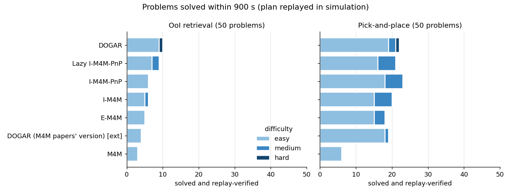
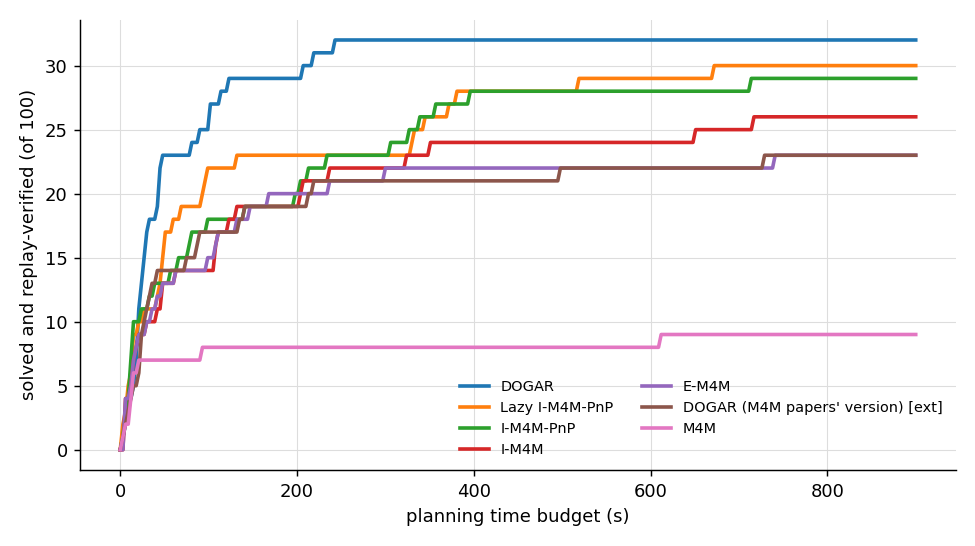

# Overnight run 6: M4M family and both DOGARs, 900 s, grid states

Experiment `workspace/experiments/20261029-230840_overnight6`; dataset `overnight6-grid` (100 problems); 7 methods, one seed, at most 900 s of planning per run, 700 runs. A run counts as solved only if its plan, replayed from the initial scene in MuJoCo, succeeds (the OoI is out of its shelf / every target is at its goal).

**Most problems solved: DOGAR, 32 of 100.**

## Solved per method and task

| Method | OoI retrieval | Pick-and-place | Total |
|---|---|---|---|
| DOGAR | 10/50 | 22/50 | **32/100** |
| Lazy I-M4M-PnP | 9/50 | 21/50 | **30/100** |
| I-M4M-PnP | 6/50 | 23/50 | **29/100** |
| I-M4M | 6/50 | 20/50 | **26/100** |
| E-M4M | 5/50 | 18/50 | **23/100** |
| DOGAR (M4M papers' version) [ext] | 4/50 | 19/50 | **23/100** |
| M4M | 3/50 | 6/50 | **9/100** |

## Solved per method and difficulty (both tasks)

| Method | easy | medium | hard | Total |
|---|---|---|---|---|
| DOGAR | 28/50 | 2/30 | 2/20 | **32/100** |
| Lazy I-M4M-PnP | 23/50 | 7/30 | 0/20 | **30/100** |
| I-M4M-PnP | 24/50 | 5/30 | 0/20 | **29/100** |
| I-M4M | 20/50 | 6/30 | 0/20 | **26/100** |
| E-M4M | 20/50 | 3/30 | 0/20 | **23/100** |
| DOGAR (M4M papers' version) [ext] | 22/50 | 1/30 | 0/20 | **23/100** |
| M4M | 9/50 | 0/30 | 0/20 | **9/100** |

## OoI retrieval: per difficulty

| Method | easy | medium | hard | Total |
|---|---|---|---|---|
| DOGAR | 9/25 | 0/15 | 1/10 | **10/50** |
| Lazy I-M4M-PnP | 7/25 | 2/15 | 0/10 | **9/50** |
| I-M4M-PnP | 6/25 | 0/15 | 0/10 | **6/50** |
| I-M4M | 5/25 | 1/15 | 0/10 | **6/50** |
| E-M4M | 5/25 | 0/15 | 0/10 | **5/50** |
| DOGAR (M4M papers' version) [ext] | 4/25 | 0/15 | 0/10 | **4/50** |
| M4M | 3/25 | 0/15 | 0/10 | **3/50** |

## Pick-and-place: per difficulty

| Method | easy | medium | hard | Total |
|---|---|---|---|---|
| DOGAR | 19/25 | 2/15 | 1/10 | **22/50** |
| Lazy I-M4M-PnP | 16/25 | 5/15 | 0/10 | **21/50** |
| I-M4M-PnP | 18/25 | 5/15 | 0/10 | **23/50** |
| I-M4M | 15/25 | 5/15 | 0/10 | **20/50** |
| E-M4M | 15/25 | 3/15 | 0/10 | **18/50** |
| DOGAR (M4M papers' version) [ext] | 18/25 | 1/15 | 0/10 | **19/50** |
| M4M | 6/25 | 0/15 | 0/10 | **6/50** |

## Solved per environment (both tasks)

| Method | confined_shelf | multi_level_shelf | tabletop | Total |
|---|---|---|---|---|
| DOGAR | 7/28 | 8/24 | 17/48 | **32/100** |
| Lazy I-M4M-PnP | 9/28 | 5/24 | 16/48 | **30/100** |
| I-M4M-PnP | 8/28 | 6/24 | 15/48 | **29/100** |
| I-M4M | 10/28 | 7/24 | 9/48 | **26/100** |
| E-M4M | 8/28 | 6/24 | 9/48 | **23/100** |
| DOGAR (M4M papers' version) [ext] | 9/28 | 6/24 | 8/48 | **23/100** |
| M4M | 4/28 | 3/24 | 2/48 | **9/100** |

## Solved within 300 / 600 / 900 s

A run's planning time tells what a run with a shorter budget would have solved.

| Method | OoI retrieval 300 s | OoI retrieval 600 s | OoI retrieval 900 s | Pick-and-place 300 s | Pick-and-place 600 s | Pick-and-place 900 s | total 300 s | total 600 s | total 900 s |
|---|---|---|---|---|---|---|---|---|---|
| DOGAR | 10 | 10 | 10 | 22 | 22 | 22 | **32** | **32** | **32** |
| Lazy I-M4M-PnP | 8 | 9 | 9 | 15 | 20 | 21 | **23** | **29** | **30** |
| I-M4M-PnP | 6 | 6 | 6 | 17 | 22 | 23 | **23** | **28** | **29** |
| I-M4M | 5 | 6 | 6 | 17 | 18 | 20 | **22** | **24** | **26** |
| E-M4M | 5 | 5 | 5 | 17 | 17 | 18 | **22** | **22** | **23** |
| DOGAR (M4M papers' version) [ext] | 4 | 4 | 4 | 17 | 18 | 19 | **21** | **22** | **23** |
| M4M | 2 | 2 | 3 | 6 | 6 | 6 | **8** | **8** | **9** |

## Planning time of the solved runs

| Method | median (s) | mean (s) | within 60 s | within 120 s | within 300 s | within 600 s | within 900 s |
|---|---|---|---|---|---|---|---|
| DOGAR | 29.1 | 56.5 | 23 | 28 | 32 | 32 | 32 |
| Lazy I-M4M-PnP | 48.0 | 129.4 | 18 | 22 | 23 | 29 | 30 |
| I-M4M-PnP | 63.8 | 136.9 | 14 | 18 | 23 | 28 | 29 |
| I-M4M | 55.1 | 137.4 | 13 | 17 | 22 | 24 | 26 |
| E-M4M | 41.3 | 101.6 | 13 | 17 | 22 | 22 | 23 |
| DOGAR (M4M papers' version) [ext] | 32.6 | 107.0 | 14 | 17 | 21 | 22 | 23 |
| M4M | 12.6 | 86.5 | 7 | 8 | 8 | 8 | 9 |

## Why runs failed

| Method | reason | runs |
|---|---|---|
| DOGAR | budget exhausted | 41 |
| DOGAR | budget exhausted  | 5 |
| DOGAR | replay failed: push 1/1 invalid on replay: off the grid: object 10 turned 38 deg off  | 2 |
| DOGAR | replay failed: push 1/2 invalid on replay: off the grid: object 11 turned 39 deg off  | 2 |
| DOGAR | replay failed: push 1/1 invalid on replay: immovable contact: obj / obj | 1 |
| DOGAR | replay failed: push 2/3 invalid on replay: off the grid: object 7 turned 43 deg off t | 1 |
| Lazy I-M4M-PnP | budget exhausted | 33 |
| Lazy I-M4M-PnP | OPEN exhausted | 6 |
| Lazy I-M4M-PnP | replay failed: push 1/2 invalid on replay: off the grid: object 10 turned 44 deg off  | 3 |
| Lazy I-M4M-PnP | no retrieval trajectory without movables | 3 |
| Lazy I-M4M-PnP | replay failed: push 1/2 invalid on replay: off the grid: object 7 turned 45 deg off t | 2 |
| Lazy I-M4M-PnP | replay failed: push 1/1 invalid on replay: off the grid: object 6 turned 45 deg off t | 1 |
| I-M4M-PnP | budget exhausted | 30 |
| I-M4M-PnP | OPEN exhausted | 9 |
| I-M4M-PnP | no retrieval trajectory without movables | 2 |
| I-M4M-PnP | replay failed: push 1/1 invalid on replay: off the grid: object 6 turned 24 deg off t | 1 |
| I-M4M-PnP | replay failed: push 7/13 invalid on replay: bodies forced into each other (x cm): o | 1 |
| I-M4M-PnP | replay failed: grasp: simulation unstable (MuJoCo reset the state) | 1 |
| I-M4M | budget exhausted | 27 |
| I-M4M | OPEN exhausted | 24 |
| I-M4M | no retrieval trajectory without movables | 2 |
| I-M4M | replay failed: push 1/1 invalid on replay: off the grid: object 6 turned 27 deg off t | 2 |
| I-M4M | replay failed: push 2/2 invalid on replay: off the grid: object 7 outside the grid's  | 1 |
| I-M4M | replay failed: push 1/1 invalid on replay: off the grid: object 6 turned 26 deg off t | 1 |
| E-M4M | budget exhausted | 25 |
| E-M4M | OPEN exhausted | 25 |
| E-M4M | no retrieval trajectory without movables | 3 |
| E-M4M | replay failed: push 1/2 invalid on replay: off the grid: object 10 turned 39 deg off  | 2 |
| E-M4M | replay failed: push 1/1 invalid on replay: off the grid: object 6 turned 27 deg off t | 2 |
| E-M4M | replay failed: push 1/4 invalid on replay: off the grid: object 8 turned 39 deg off t | 1 |
| DOGAR (M4M papers' version) [ext] | budget exhausted | 57 |
| DOGAR (M4M papers' version) [ext] | no retrieval trajectory without movables | 2 |
| DOGAR (M4M papers' version) [ext] | replay failed: push 1/2 invalid on replay: object 7 tilted 25 deg | 1 |
| DOGAR (M4M papers' version) [ext] | replay failed: push 1/1 invalid on replay: off the grid: object 6 turned 34 deg off t | 1 |
| DOGAR (M4M papers' version) [ext] | replay failed: push 1/1 invalid on replay: off the grid: object 6 turned 19 deg off t | 1 |
| DOGAR (M4M papers' version) [ext] | replay failed: push 1/3 invalid on replay: off the grid: object 7 outside the grid's  | 1 |
| M4M | budget exhausted | 43 |
| M4M | no MAPF-suggested push left | 33 |
| M4M | no retrieval trajectory without movables | 2 |
| M4M | replay failed: push 1/2 invalid on replay: off the grid: object 10 turned 24 deg off  | 1 |
| M4M | replay failed: push 2/2 invalid on replay: off the grid: object 10 turned 21 deg off  | 1 |
| M4M | replay failed: push 1/4 invalid on replay: off the grid: object 11 turned 29 deg off  | 1 |

## Feasibility of the problems

From `scripts/feasibility.py` (`dataset/feasibility.csv`): **feasible** = some method (a baseline or the oracle witness search, `mamo/oracle`) found a plan that replays successfully with the current simulator; **infeasible** = a necessary condition fails (the target cannot be retrieved / picked and placed in simulation even with every movable removed, 20 seeds, or the free surface is too small); **unknown** = neither.

| Task | Difficulty | feasible | infeasible | unknown |
|---|---|---|---|---|
| OoI retrieval | easy | 14 | 0 | 11 |
| OoI retrieval | medium | 3 | 0 | 12 |
| OoI retrieval | hard | 1 | 0 | 9 |
| Pick-and-place | easy | 24 | 0 | 1 |
| Pick-and-place | medium | 8 | 0 | 7 |
| Pick-and-place | hard | 1 | 1 | 8 |

Solved (replay-verified) of the 51 problems known to be feasible:

| Method | solved | of feasible |
|---|---|---|
| DOGAR | 32 | 63% |
| Lazy I-M4M-PnP | 30 | 59% |
| I-M4M-PnP | 29 | 57% |
| I-M4M | 26 | 51% |
| E-M4M | 23 | 45% |
| DOGAR (M4M papers' version) [ext] | 23 | 45% |
| M4M | 9 | 18% |

## Notes

**The run.** This is overnight run 6, with the same setup as `../overnight6-nogrid/notes.md`: 7 methods (the M4M family, DOGAR and `dogar_m4m`), planners as in their papers (`grid.planners = False`), one 900 s run per problem read at 300 / 600 / 900 s, friction 0.8, and the new push defaults (5 cm back-off, 2 cm push height). There are three environments: confined shelf (28), multi-level shelf (24) and tabletop (48). The dataset `overnight6-grid` holds the same 100 problems as the no-grid copy, with the grid rule on and judged at replay. Every push and pick-and-place, and the final state, must leave each object squarely in a cell of its own.

**Solved and replayed: 300 / 600 / 900 s, overnight5 (300 s, same problems, paper push) and the no-grid copy (900 s):**

| Method | 300 s | 600 s | 900 s | overnight5 | no grid |
|---|---|---|---|---|---|
| DOGAR (2011) | 32 | 32 | **32** | 32 | 59 |
| Lazy I-M4M-PnP | 23 | 29 | **30** | 20 | 65 |
| I-M4M-PnP | 23 | 28 | **29** | 21 | 59 |
| I-M4M | 22 | 24 | **26** | 19 | 53 |
| E-M4M | 22 | 22 | **23** | 20 | 57 |
| DOGAR, M4M papers' version [ext] | 21 | 22 | **23** | - | 42 |
| M4M | 8 | 8 | **9** | 9 | 24 |

**Per environment at 900 s (confined / multi-level / tabletop):** DOGAR 7 / 8 / 17, Lazy I-M4M-PnP 9 / 5 / 16, I-M4M-PnP 8 / 6 / 15, I-M4M 10 / 7 / 9, E-M4M 8 / 6 / 9, `dogar_m4m` 9 / 6 / 8, M4M 4 / 3 / 2.

* **The grid, not the planners, sets the result here.** Many plans that the planners find fail at replay, and almost all of those failures are the grid rule:

| Method | plans found | failed replay | off the grid | of which a box turned | pushes / pick-and-places in the plans found |
|---|---|---|---|---|---|
| DOGAR | 54 | 22 | 19 | 17 | 32 / 73 |
| Lazy I-M4M-PnP | 58 | 28 | 24 | 17 | 50 / 140 |
| I-M4M-PnP | 59 | 30 | 24 | 19 | 68 / 156 |
| I-M4M | 47 | 21 | 21 | 19 | 99 / 20 |
| E-M4M | 47 | 24 | 24 | 20 | 90 / 18 |
| `dogar_m4m` | 41 | 18 | 16 | 14 | 56 / 19 |
| M4M | 22 | 13 | 11 | 11 | 40 / 6 |

  Most of them are a pushed box that ends **turned** in its cell (the pick-and-places include the final grasp of the OoI or target). The planners do not know the grid (as in their papers), and a push rarely moves a box without rotating it.
* **The push change helps only a little with the grid.** At 300 s the M4M family gains 2-3 solves over overnight5 (M4M loses 1), against 10-20 without the grid. The better pushes reach simulation and replay, then fail the grid rule. DOGAR solves exactly overnight5's 32 problems again.
* **DOGAR leads, ahead of Lazy I-M4M-PnP (30) and I-M4M-PnP (29).** Its plans have the fewest pushes (32 in 54 plans), and 41 % of them fail replay, against 44-59 % for the others. The other methods are within a few problems of each other, and `dogar_m4m` ties E-M4M at 23.
* **More time helps the pick-and-place methods.** From 300 s to 900 s, Lazy I-M4M-PnP gains 7 (6 of them pick-and-place problems) and I-M4M-PnP gains 6 (all pick-and-place). DOGAR finds nothing more after 300 s.
* **Retrieval with the grid is nearly unsolved.** At most 10 of 50 (DOGAR), and the M4M family solves 3-9.

**If clearing the way were enough (`grid_relaxed_replay.jsonl`, 2026-10-30).** The 139 plans that failed replay only on the grid (all of them OoI retrievals) were replayed again with the grid rule off. 118 succeed: the OoI comes out and no interaction constraint is violated. Counted as solved, the totals would be DOGAR 51, Lazy I-M4M-PnP 49, I-M4M-PnP 48, I-M4M 44, E-M4M 44, `dogar_m4m` 37, M4M 17. No pick-and-place plan fails on the grid at the final replay: `mamo.relocate` replays every stage with the grid rule and plans the stage again if it fails, so pick-and-place plans are already on the grid when they are returned.

**Feasibility (`dataset/feasibility.csv`).** 51 feasible, 1 infeasible and 48 unknown (overnight5: 49 / 2 / 49). The reach and space checks are shared with the no-grid copy. `open_tabletop_relocate_easy_0000`, labelled infeasible in overnight5, is solved by I-M4M-PnP here (see the no-grid notes).

**Repro.** `python scripts/overnight6_pipeline.py --workers 8 --budget 900` (it resumes from `../pipeline_state.json`). Earlier overnight results are unchanged.

## Files

* `results.csv`: one row per run
* `<baseline>/results.csv`, `<baseline>/solutions/<task>/*.pkl` (plans, `mamo.solution.Solution`), `<baseline>/gifs/<task>/*.gif` (every solved run replayed, iso and top view)
* `dataset/`: the problems (scene files), `dataset/labels.csv` their labels, `dataset/index.html` a gallery of every problem (`dataset/gifs/<task>/<env>/<scene>.gif` and top views)
