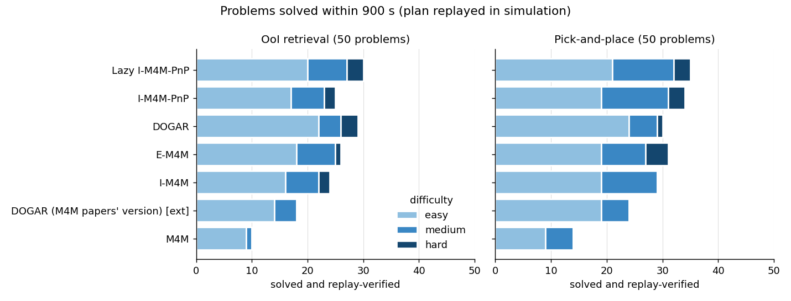
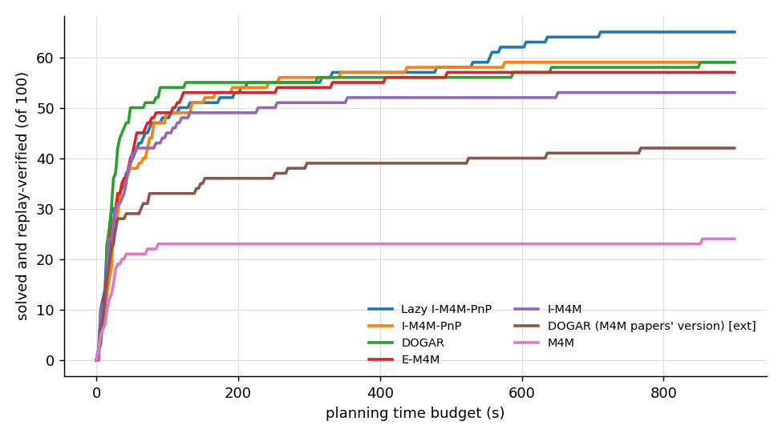

# Overnight run 6: M4M family and both DOGARs, 900 s, continuous states

Experiment `workspace/experiments/20261029-230840_overnight6`; dataset `overnight6-nogrid` (100 problems); 7 methods, one seed, at most 900 s of planning per run, 700 runs. A run counts as solved only if its plan, replayed from the initial scene in MuJoCo, succeeds (the OoI is out of its shelf / every target is at its goal).

**Most problems solved: Lazy I-M4M-PnP, 65 of 100.**

## Solved per method and task

| Method | OoI retrieval | Pick-and-place | Total |
|---|---|---|---|
| Lazy I-M4M-PnP | 30/50 | 35/50 | **65/100** |
| I-M4M-PnP | 25/50 | 34/50 | **59/100** |
| DOGAR | 29/50 | 30/50 | **59/100** |
| E-M4M | 26/50 | 31/50 | **57/100** |
| I-M4M | 24/50 | 29/50 | **53/100** |
| DOGAR (M4M papers' version) [ext] | 18/50 | 24/50 | **42/100** |
| M4M | 10/50 | 14/50 | **24/100** |

## Solved per method and difficulty (both tasks)

| Method | easy | medium | hard | Total |
|---|---|---|---|---|
| Lazy I-M4M-PnP | 41/50 | 18/30 | 6/20 | **65/100** |
| I-M4M-PnP | 36/50 | 18/30 | 5/20 | **59/100** |
| DOGAR | 46/50 | 9/30 | 4/20 | **59/100** |
| E-M4M | 37/50 | 15/30 | 5/20 | **57/100** |
| I-M4M | 35/50 | 16/30 | 2/20 | **53/100** |
| DOGAR (M4M papers' version) [ext] | 33/50 | 9/30 | 0/20 | **42/100** |
| M4M | 18/50 | 6/30 | 0/20 | **24/100** |

## OoI retrieval: per difficulty

| Method | easy | medium | hard | Total |
|---|---|---|---|---|
| Lazy I-M4M-PnP | 20/25 | 7/15 | 3/10 | **30/50** |
| I-M4M-PnP | 17/25 | 6/15 | 2/10 | **25/50** |
| DOGAR | 22/25 | 4/15 | 3/10 | **29/50** |
| E-M4M | 18/25 | 7/15 | 1/10 | **26/50** |
| I-M4M | 16/25 | 6/15 | 2/10 | **24/50** |
| DOGAR (M4M papers' version) [ext] | 14/25 | 4/15 | 0/10 | **18/50** |
| M4M | 9/25 | 1/15 | 0/10 | **10/50** |

## Pick-and-place: per difficulty

| Method | easy | medium | hard | Total |
|---|---|---|---|---|
| Lazy I-M4M-PnP | 21/25 | 11/15 | 3/10 | **35/50** |
| I-M4M-PnP | 19/25 | 12/15 | 3/10 | **34/50** |
| DOGAR | 24/25 | 5/15 | 1/10 | **30/50** |
| E-M4M | 19/25 | 8/15 | 4/10 | **31/50** |
| I-M4M | 19/25 | 10/15 | 0/10 | **29/50** |
| DOGAR (M4M papers' version) [ext] | 19/25 | 5/15 | 0/10 | **24/50** |
| M4M | 9/25 | 5/15 | 0/10 | **14/50** |

## Solved per environment (both tasks)

| Method | confined_shelf | multi_level_shelf | tabletop | Total |
|---|---|---|---|---|
| Lazy I-M4M-PnP | 22/28 | 19/24 | 24/48 | **65/100** |
| I-M4M-PnP | 19/28 | 20/24 | 20/48 | **59/100** |
| DOGAR | 16/28 | 16/24 | 27/48 | **59/100** |
| E-M4M | 21/28 | 18/24 | 18/48 | **57/100** |
| I-M4M | 18/28 | 18/24 | 17/48 | **53/100** |
| DOGAR (M4M papers' version) [ext] | 11/28 | 16/24 | 15/48 | **42/100** |
| M4M | 6/28 | 13/24 | 5/48 | **24/100** |

## Solved within 300 / 600 / 900 s

A run's planning time tells what a run with a shorter budget would have solved.

| Method | OoI retrieval 300 s | OoI retrieval 600 s | OoI retrieval 900 s | Pick-and-place 300 s | Pick-and-place 600 s | Pick-and-place 900 s | total 300 s | total 600 s | total 900 s |
|---|---|---|---|---|---|---|---|---|---|
| Lazy I-M4M-PnP | 25 | 30 | 30 | 30 | 32 | 35 | **55** | **62** | **65** |
| I-M4M-PnP | 24 | 25 | 25 | 32 | 34 | 34 | **56** | **59** | **59** |
| DOGAR | 29 | 29 | 29 | 26 | 28 | 30 | **55** | **57** | **59** |
| E-M4M | 24 | 26 | 26 | 30 | 31 | 31 | **54** | **57** | **57** |
| I-M4M | 22 | 23 | 24 | 29 | 29 | 29 | **51** | **52** | **53** |
| DOGAR (M4M papers' version) [ext] | 18 | 18 | 18 | 21 | 22 | 24 | **39** | **40** | **42** |
| M4M | 10 | 10 | 10 | 13 | 13 | 14 | **23** | **23** | **24** |

## Planning time of the solved runs

| Method | median (s) | mean (s) | within 60 s | within 120 s | within 300 s | within 600 s | within 900 s |
|---|---|---|---|---|---|---|---|
| Lazy I-M4M-PnP | 31.6 | 118.1 | 43 | 50 | 55 | 62 | 65 |
| I-M4M-PnP | 30.9 | 72.1 | 39 | 49 | 56 | 59 | 59 |
| DOGAR | 20.0 | 64.9 | 50 | 54 | 55 | 57 | 59 |
| E-M4M | 26.4 | 57.3 | 45 | 52 | 54 | 57 | 57 |
| I-M4M | 23.8 | 59.0 | 42 | 48 | 51 | 52 | 53 |
| DOGAR (M4M papers' version) [ext] | 19.7 | 92.4 | 29 | 33 | 39 | 40 | 42 |
| M4M | 17.6 | 56.7 | 21 | 23 | 23 | 23 | 24 |

## Why runs failed

| Method | reason | runs |
|---|---|---|
| Lazy I-M4M-PnP | budget exhausted | 18 |
| Lazy I-M4M-PnP | OPEN exhausted | 6 |
| Lazy I-M4M-PnP | no retrieval trajectory without movables | 3 |
| Lazy I-M4M-PnP | replay failed: grasp failed: the fingers do not both touch the OoI | 3 |
| Lazy I-M4M-PnP | replay failed: push 3/5 invalid on replay: bodies forced into each other (x cm): sh | 1 |
| Lazy I-M4M-PnP | replay failed: push 1/1 invalid on replay: bodies forced into each other (x cm): sh | 1 |
| I-M4M-PnP | budget exhausted | 18 |
| I-M4M-PnP | OPEN exhausted | 11 |
| I-M4M-PnP | no retrieval trajectory without movables | 2 |
| I-M4M-PnP | replay failed: grasp failed: the fingers do not both touch the OoI | 2 |
| I-M4M-PnP | replay failed: push 3/7 invalid on replay: bodies forced into each other (x cm): ob | 2 |
| I-M4M-PnP | replay failed: push 9/10 invalid on replay: bodies forced into each other (x cm): s | 1 |
| DOGAR | budget exhausted | 37 |
| DOGAR | replay failed: push 1/2 invalid on replay: object 7 tilted 25 deg | 1 |
| DOGAR | replay failed: push 1/4 invalid on replay: bodies forced into each other (x cm) | 1 |
| DOGAR | replay failed: push 1/1 invalid on replay: immovable contact: obj / obj | 1 |
| DOGAR | replay failed: push 2/2 invalid on replay: immovable contact: obj / robot/right_fin | 1 |
| E-M4M | OPEN exhausted | 23 |
| E-M4M | budget exhausted | 15 |
| E-M4M | replay failed: grasp failed: the fingers do not both touch the OoI | 3 |
| E-M4M | no retrieval trajectory without movables | 2 |
| I-M4M | OPEN exhausted | 23 |
| I-M4M | budget exhausted | 19 |
| I-M4M | replay failed: grasp failed: the fingers do not both touch the OoI | 3 |
| I-M4M | no retrieval trajectory without movables | 2 |
| DOGAR (M4M papers' version) [ext] | budget exhausted | 51 |
| DOGAR (M4M papers' version) [ext] | no retrieval trajectory without movables | 2 |
| DOGAR (M4M papers' version) [ext] | replay failed: push 1/1 invalid on replay: object 10 tilted 25 deg | 1 |
| DOGAR (M4M papers' version) [ext] | replay failed: push 2/4 invalid on replay: object 7 tilted 25 deg | 1 |
| DOGAR (M4M papers' version) [ext] | replay failed: push 1/2 invalid on replay: object 7 tilted 25 deg | 1 |
| DOGAR (M4M papers' version) [ext] | replay failed: grasp failed: the fingers do not both touch the OoI | 1 |
| M4M | budget exhausted | 37 |
| M4M | no MAPF-suggested push left | 31 |
| M4M | no retrieval trajectory without movables | 2 |
| M4M | replay failed: grasp failed: the fingers do not both touch the OoI | 2 |
| M4M | replay failed: grasp: simulation unstable (MuJoCo reset the state) | 2 |
| M4M | replay failed: push 1/4 invalid on replay: object 4 tilted 25 deg | 1 |

## Feasibility of the problems

From `scripts/feasibility.py` (`dataset/feasibility.csv`): **feasible** = some method (a baseline or the oracle witness search, `mamo/oracle`) found a plan that replays successfully with the current simulator; **infeasible** = a necessary condition fails (the target cannot be retrieved / picked and placed in simulation even with every movable removed, 20 seeds, or the free surface is too small); **unknown** = neither.

| Task | Difficulty | feasible | infeasible | unknown |
|---|---|---|---|---|
| OoI retrieval | easy | 24 | 0 | 1 |
| OoI retrieval | medium | 10 | 0 | 5 |
| OoI retrieval | hard | 5 | 0 | 5 |
| Pick-and-place | easy | 25 | 0 | 0 |
| Pick-and-place | medium | 13 | 0 | 2 |
| Pick-and-place | hard | 5 | 1 | 4 |

Solved (replay-verified) of the 82 problems known to be feasible:

| Method | solved | of feasible |
|---|---|---|
| Lazy I-M4M-PnP | 65 | 79% |
| I-M4M-PnP | 59 | 72% |
| DOGAR | 59 | 72% |
| E-M4M | 57 | 70% |
| I-M4M | 53 | 65% |
| DOGAR (M4M papers' version) [ext] | 42 | 51% |
| M4M | 24 | 29% |

## Notes

**The run.** Overnight run 6 (2026-10-29 23:08 to 2026-10-30 17:32, planning). It runs 7 methods: the M4M family, DOGAR (Dogar & Srinivasa's own planner) and `dogar_m4m` (DOGAR as the M4M papers re-implement it, [ext]). The planners run as in their papers (`grid.planners = False`), with friction 0.8, 8 runs in parallel and **one 900 s run per problem**. Planners stop at their first solution, so a run's planning time also gives what a 300 s or 600 s run would have solved.

The 100 problems are overnight5's, regrouped into three environments: confined shelf (confined shelf + Access-19, 28 problems), multi-level shelf (24) and tabletop (open tabletop + 3D stacking, 48). This copy has continuous states, as in the papers. Both copies ran interleaved in one experiment (`workspace/experiments/20261029-230840_overnight6`). The grid copy has its own notes in `../overnight6-grid/notes.md`.

**What changed since overnight5 (decided 2026-10-29, `results/push_diagnosis/notes.md`).** The M4M family and `dogar_m4m` now start pushes 5 cm back from the object, as the authors' code does (`push.backoff = 0.05`), and push 2 cm above the surface (`push.height_above_shelf = 0.02`; the paper uses 3 cm). DOGAR's sweeps stay at 3 cm. Nothing else changed.

**Solved and replayed: 300 / 600 / 900 s, and overnight5 (300 s, same problems, paper push):**

| Method | 300 s | 600 s | 900 s | overnight5 |
|---|---|---|---|---|
| Lazy I-M4M-PnP | 55 | 62 | **65** | 42 |
| I-M4M-PnP | 56 | 59 | **59** | 46 |
| DOGAR (2011) | 55 | 57 | **59** | 55 |
| E-M4M | 54 | 57 | **57** | 34 |
| I-M4M | 51 | 52 | **53** | 39 |
| DOGAR, M4M papers' version [ext] | 39 | 40 | **42** | - |
| M4M | 23 | 23 | **24** | 28 |

**Per environment at 900 s, and overnight5 at 300 s (confined / multi-level / tabletop):**

| Method | confined shelf (28) | multi-level shelf (24) | tabletop (48) | overnight5 |
|---|---|---|---|---|
| Lazy I-M4M-PnP | 22 | 19 | 24 | 10 / 14 / 18 |
| I-M4M-PnP | 19 | 20 | 20 | 12 / 17 / 17 |
| DOGAR (2011) | 16 | 16 | **27** | 15 / 15 / 25 |
| E-M4M | 21 | 18 | 18 | 6 / 14 / 14 |
| I-M4M | 18 | 18 | 17 | 6 / 15 / 18 |
| DOGAR, M4M papers' version | 11 | 16 | 15 | - |
| M4M | 6 | 13 | 5 | 8 / 12 / 8 |

* **The push change is what the M4M family needed.** At the same 300 s, E-M4M goes from 34 to 54 solved, I-M4M from 39 to 51, I-M4M-PnP from 46 to 56 and Lazy I-M4M-PnP from 42 to 55. DOGAR, which did not change, solves exactly the same 55 problems as in overnight5. So the comparison is fair, and the gain comes from the push start and height. The largest gain is on the confined shelf (E-M4M 6 to 18 at 300 s), where pushes are the only way to clear the way.
* **The M4M family now matches or beats DOGAR.** At 900 s the order is Lazy I-M4M-PnP 65, then I-M4M-PnP and DOGAR 59, E-M4M 57, I-M4M 53. DOGAR still leads on the tabletop (27 of 48), where it can pick objects up and set them down anywhere. The M4M family leads on both shelves.
* **Against the DOGAR the papers tested, the papers' result holds.** The push-only `dogar_m4m` solves 42, against E-M4M's 57 and I-M4M's 53, and none of the 20 hard problems. Dogar's own planner solves 59 because of its PickUps.
* **M4M does not improve (28 to 24 at 900 s).** It loses 14 overnight5 solves and gains 10. M4M follows one CBS solution and stops when its suggested pushes run out ("no MAPF-suggested push left", 31 runs). The longer, backed-off pushes fail push IK more often, which ends those runs sooner. E-M4M, which replans CBS, does not have this problem.
* **More time helps a little.** From 300 s to 900 s the methods gain 1-3 solves, except Lazy I-M4M-PnP (+10), which keeps finding plans after 300 s on both tasks (+5 each).
* **Plans replay.** 3-10 plans per method fail the replay, mostly grasps where one finger misses the OoI and pushes where bodies are forced into each other.
* **Hard problems stay hard.** At most 6 of 20 (Lazy I-M4M-PnP).

**Feasibility (`dataset/feasibility.csv`).** 82 feasible (each with a replayed plan from this run), 1 infeasible and 17 unknown (overnight5: 73 / 2 / 25). One overnight5 "infeasible" problem, `open_tabletop_relocate_easy_0000`, is solved here by I-M4M-PnP on both copies. The infeasibility check is sampled (20 seeds of pick-and-place with every movable removed), so it can be wrong, and this label was.

**Repro.** `python scripts/overnight6_pipeline.py --workers 8 --budget 900` (it resumes from `../pipeline_state.json`). Earlier overnight results are unchanged.

## Files

* `results.csv`: one row per run
* `<baseline>/results.csv`, `<baseline>/solutions/<task>/*.pkl` (plans, `mamo.solution.Solution`), `<baseline>/gifs/<task>/*.gif` (every solved run replayed, iso and top view)
* `dataset/`: the problems (scene files), `dataset/labels.csv` their labels, `dataset/index.html` a gallery of every problem (`dataset/gifs/<task>/<env>/<scene>.gif` and top views)
